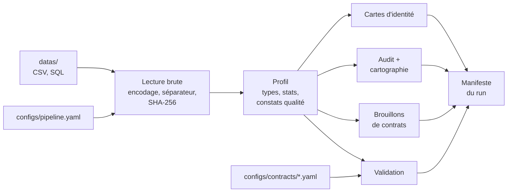

# InduSense 4.0 — pipeline d'ingestion et de qualité des données

Projet fil rouge (maintenance prédictive) de la formation **« Concevoir et implémenter une
solution d'IA »**. Sprint 1 : *cadrer et fiabiliser les données* (compétences C1, C2, C3).

Le pipeline est **piloté par la configuration** et **découvre seul les fichiers** de `datas/` :
une nouvelle source se traite en déposant le fichier et en ajoutant son contrat dans
`configs/contracts/`, sans écrire de code ni déclarer de nom de fichier.

## Démarrage

```bash
uv sync                               # dépendances (pandas, pyyaml, sqlglot) + outils de dev
uv run indusense run                  # toutes les étapes
uv run pytest                         # tests
```

| Commande | Étape | Sorties (`artifacts/ingestion/…`) |
|---|---|---|
| `uv run indusense identity` | Cartes d'identité (TP1) | `identities/AAAAMMJJ/<fichier>_HHMMSS.md` |
| `uv run indusense audit` | Audit qualité + cartographie | `audits/AAAAMMJJ/<jeu>_HHMMSS.md/.json`, `cartographie_*.md` |
| `uv run indusense contract draft` | Brouillons de contrats (observé) | `contracts/drafts/<run_id>/<jeu>.yaml` |
| `uv run indusense contract check` | Structure des contrats | console (code retour 1 si invalide) |
| `uv run indusense validate` | Données vs contrats (attendu) | `validations/AAAAMMJJ/validation_*.md/.json` |
| `uv run indusense run` | Tout | + `runs/<run_id>/manifest.json` |

Option `--source <id>` (répétable) pour ne traiter qu'une partie des sources. L'identifiant
d'une source est le nom de son fichier sans extension (`telemetry.csv` → `telemetry`,
`machine.sql` → `machine`).

## Découverte des sources

Tout fichier de `datas/` correspondant à un motif de `discovery.patterns` est traité
(par défaut `*.csv`, `*.tsv`, `*.sql`, `*.sql.txt`). Encodage et séparateur sont détectés,
le format est déduit de l'extension. Pour imposer une option de lecture, on ajoute une règle
**par motif** dans `discovery.overrides` (la dernière règle qui correspond l'emporte) :

```yaml
discovery:
  patterns: ["*.csv", "*.tsv", "*.sql", "*.sql.txt"]
  overrides:
    - match: "*.sql*"          # tous les scripts SQL
      format: sql
      sql_dialect: postgres
    - match: "export_*.csv"    # exemple : exports d'un logiciel en cp1252 et « ; »
      encoding: cp1252
      separator: ";"
```

Si deux fichiers ont le même nom de base (`machine.csv` et `machine.sql`), le second reçoit un
identifiant tiré de son nom complet (`machine_sql`) et un avertissement est affiché.

## Flux



## Arborescence

```
indusense/
├── .claude/
│   └── skills/                         # savoir-faire réutilisable par l'agent IA
│       ├── data-identity-card/SKILL.md #   inventaire d'un fichier (TP1)
│       ├── data-audit/SKILL.md         #   audit qualité + interprétation des constats
│       └── data-contract/SKILL.md      #   contrats : création, validation, échecs, versions
├── CLAUDE.md                           # règles du projet pour l'agent (Git, données, code)
├── configs/
│   ├── pipeline.yaml                   # chemins, découverte des sources, seuils d'inférence et d'audit
│   └── contracts/                      # contrats de données = ce qu'on ATTEND
│       ├── releves_incidents.yaml
│       ├── telemetry.yaml
│       ├── machine.yaml                #   table `machine` du script SQL
│       └── maintenance.yaml            #   table `maintenance` du script SQL
├── datas/                              # sources brutes, lecture seule (non versionnées)
├── docs/
│   ├── methodo/data_audit.md           # guide méthodologique (CRISP-DM, ISO 25012, RGPD)
│   └── datasheets/TEMPLATE.md          # modèle de datasheet (Gebru et al.)
├── notebooks/
│   └── 01_audit_journal_de_bord.ipynb  # exécution + interprétation + décisions (livrable)
├── src/indusense/
│   ├── config.py                       # lecture de pipeline.yaml en objets typés
│   ├── io/
│   │   ├── files.py                    # source, taille, SHA-256, encodage
│   │   └── readers.py                  # CSV (séparateur auto) et SQL (sqlglot) -> Dataset
│   ├── profiling/
│   │   ├── types.py                    # inférence de types (règles du TP1)
│   │   ├── profile.py                  # statistiques + constats par dimension de qualité
│   │   └── relations.py                # relations, orphelines, ERD Mermaid
│   ├── contracts/
│   │   ├── model.py                    # format YAML, contrôle de structure
│   │   ├── draft.py                    # brouillon de contrat depuis le profil observé
│   │   └── validate.py                 # contrôle des données contre le contrat
│   ├── reporting/markdown.py           # rendu des cartes, audits, validations
│   ├── pipeline.py                     # orchestration des étapes + manifeste
│   └── cli.py                          # commande `indusense`
├── tests/                              # pytest : io, typage, contrats, pipeline
├── artifacts/ingestion/                # sorties générées (seuls les manifestes sont versionnés)
│   ├── identities/  audits/  validations/
│   ├── contracts/drafts/
│   └── runs/<run_id>/manifest.json
├── pyproject.toml
└── .gitignore
```

## Principes

- **Séparation config / code / décisions** : les seuils sont dans `pipeline.yaml`, les attentes
  dans les contrats, le raisonnement dans le notebook. Le code ne contient aucune valeur métier.
- **Observé ≠ attendu** : un brouillon de contrat décrit les données telles qu'elles sont ; le
  contrat validé décrit ce qu'elles doivent être. On ne l'assouplit pas pour « faire passer ».
- **Lecture brute** : tout est lu en texte (`dtype=str`), puis typé explicitement. Aucune
  conversion silencieuse de pandas (décimales à virgule, dates ambiguës).
- **Traçabilité** : chaque run écrit un manifeste avec l'empreinte SHA-256 des entrées, celle de
  la configuration et les versions des outils.
- **CSV et SQL, même traitement** : un script SQL devient un jeu de données par table
  (`CREATE TABLE` + `INSERT`), puis suit le même chemin que les CSV.

## Ajouter une nouvelle source

1. Déposer le fichier dans `datas/` : il est découvert automatiquement. Si sa lecture demande
   une option particulière, ajouter une règle par motif dans `discovery.overrides`.
2. `uv run indusense identity` puis `uv run indusense audit` : lire la carte et l'audit.
3. `uv run indusense contract draft` : copier le brouillon dans `configs/contracts/`, le compléter.
4. `uv run indusense contract check` puis `uv run indusense validate`.
5. Interpréter et décider dans le notebook ; compléter la datasheet.
