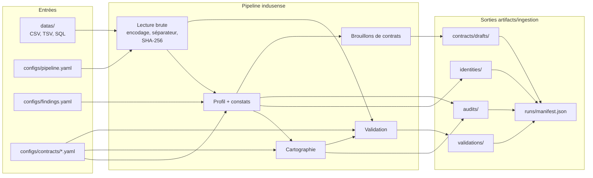
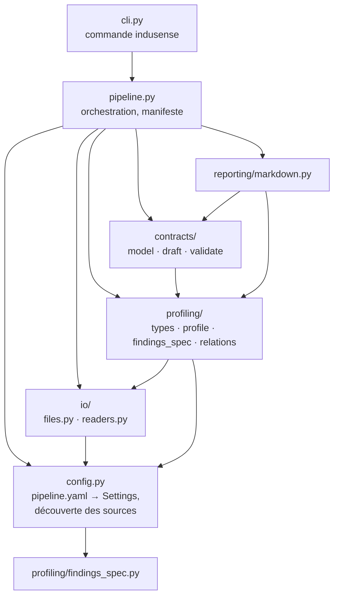
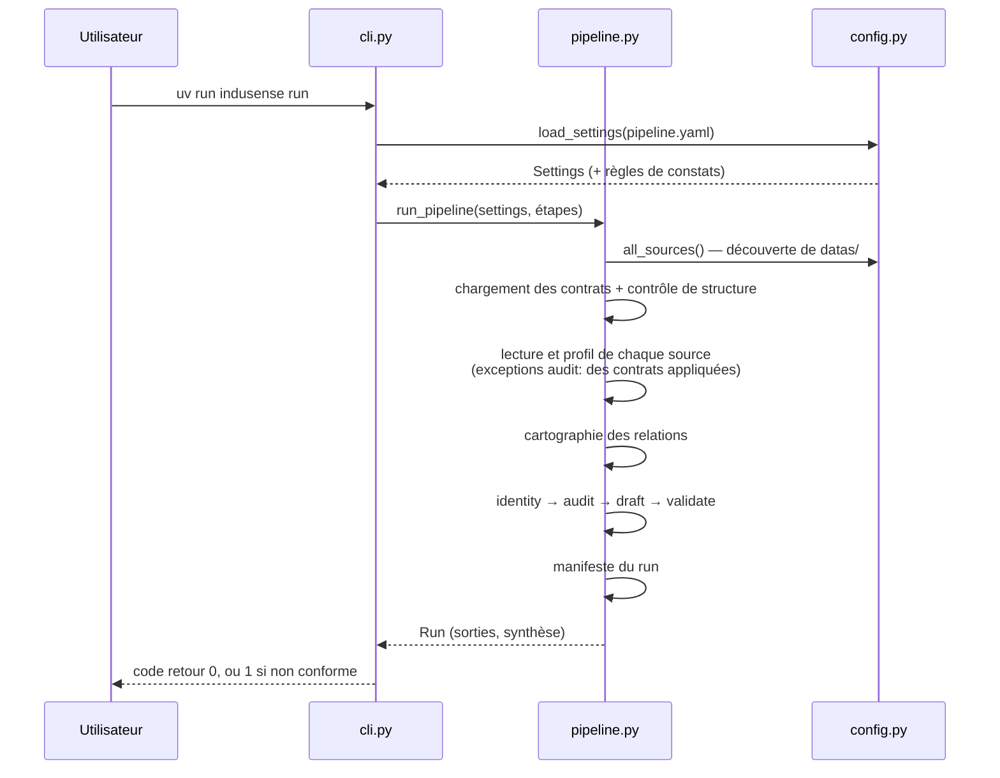

# Dossier d'architecture

## 1. Vue d'ensemble

InduSense est un **package Python** (`src/indusense/`) exposé par une **commande en ligne**
(`indusense`). Il lit des fichiers de données, produit des rapports et ne modifie jamais les
sources. Tout ce qui dépend du cas d'usage est sorti du code, dans des fichiers versionnés :

| Ce qui varie selon le projet | Où |
|---|---|
| chemins, motifs de découverte, options de lecture, inférence | `configs/pipeline.yaml` |
| textes, sévérités, seuils et hypothèses des constats | `configs/findings.yaml` (sur le catalogue `default_findings.yaml`) |
| attendu de chaque jeu de données | `configs/contracts/<jeu>.yaml` |
| interprétation et décisions | `notebooks/01_audit_journal_de_bord.ipynb` |

## 2. Position dans l'architecture de données

Le pipeline intervient **avant la couche Bronze** d'une architecture « médaillon »
(Bronze : données brutes historisées ; Silver : nettoyées ; Gold : prêtes à l'usage). Il
répond à la question « que contiennent ces fichiers, et sont-ils conformes à ce qu'on
attend ? » ; il ne construit aucune couche. Le guide [data_audit.md](methodo/data_audit.md)
détaille cette position.

## 3. Découpage en modules

| Module | Responsabilité | Ne fait pas |
|---|---|---|
| `config.py` | charge `pipeline.yaml` en objets typés (`Settings`) ; découvre les fichiers ; charge les règles de constats | aucune lecture de données |
| `io/files.py` | métadonnées d'un fichier : taille, SHA-256, encodage | — |
| `io/readers.py` | lit CSV et SQL en `Dataset` (valeurs en texte brut) | aucun typage, aucune conversion |
| `profiling/types.py` | inférence du type logique d'une colonne, convertisseurs | — |
| `profiling/findings_spec.py` | règles de constats : chargement, fusion des trois niveaux, contrôle des gabarits | aucune mesure |
| `profiling/profile.py` | statistiques et **détecteurs** (mesures) ; émet les constats via les règles | aucun texte de constat en dur |
| `profiling/relations.py` | relations entre jeux de données, orphelines, diagramme Mermaid | — |
| `contracts/model.py` | format YAML des contrats, chargement, contrôle de structure | — |
| `contracts/draft.py` | brouillon de contrat depuis le profil observé | n'écrit jamais dans `configs/` |
| `contracts/validate.py` | contrôle des données contre le contrat | aucune correction des données |
| `reporting/markdown.py` | rendu Markdown des cartes, audits, cartographie, validation | aucun calcul |
| `pipeline.py` | enchaîne les étapes, écrit les artefacts horodatés et le manifeste | — |
| `cli.py` | arguments de la commande, codes retour | — |
| `layers/migrate.py` | migrations Alembic du Bronze : structure attendue calculée depuis les contrats et les fichiers, génération (opérations destructrices signalées), application, vérification | aucune migration appliquée sans commande explicite ; le chargement ne crée aucune table |

Le point de passage commun est l'objet **`Dataset`** (identifiant, `DataFrame` de textes,
table SQL éventuelle, types SQL déclarés) : un fichier CSV en donne un, un script SQL en donne
un par table. En aval, CSV et SQL suivent exactement le même chemin.

## 4. Déroulement d'une exécution

## 5. Décisions de conception

| # | Décision | Raison | Conséquence |
|---|---|---|---|
| D1 | Lecture de tout en texte (`dtype=str`), typage explicite ensuite | pandas convertit silencieusement (virgules décimales, dates ambiguës, `NA`) | le type inféré est une décision traçable, pas un effet de bord |
| D2 | Pilotage par configuration, découverte automatique des fichiers | réutilisabilité sur d'autres données sans code | déposer un fichier suffit ; les options de lecture se fixent par motif |
| D3 | Constats = détecteurs génériques + règles en YAML sur trois niveaux | le code reste générique ; l'interprétation vient du métier | sans spécification, rapports factuels ; une hypothèse est toujours attribuable |
| D4 | Observé (brouillon) ≠ attendu (contrat) | un contrat recopié des données valide n'importe quoi | les brouillons vont dans `artifacts/`, les contrats dans `configs/` |
| D5 | Contrats au format YAML inspiré de l'Open Data Contract Standard, simplifié | lisible par le métier, versionnable | pas de dépendance à un outil externe |
| D6 | SQL analysé avec `sqlglot`, sans base de données | aucune infrastructure nécessaire, dialecte configurable | seuls `CREATE TABLE` et `INSERT … VALUES` sont exploités |
| D7 | Artefacts horodatés (un nouveau jeu de fichiers par run) ; manifeste par run | comparer deux exécutions, prouver ce qui a été traité | le dossier `artifacts/` grossit : purge manuelle possible |
| D8 | Seuls les manifestes sont versionnés | données et rapports peuvent contenir des données personnelles | rapports régénérables avec `uv run indusense run` |
| D9 | Aucune dépendance de détection d'encodage externe | légèreté, comportement explicable | détection limitée à UTF-8 (± BOM), Windows-1252, ISO-8859-1 |

## 6. Dépendances

| Paquet | Usage |
|---|---|
| `pandas` ≥ 3.1 | manipulation des colonnes, statistiques |
| `pyyaml` ≥ 6.0 | configuration, contrats, règles de constats |
| `sqlglot` ≥ 27 | analyse des scripts SQL |
| `sqlalchemy` ≥ 2.1, `psycopg` ≥ 3.3 | description des tables et dialogue avec PostgreSQL (couches) |
| `alembic` ≥ 1.16 | migrations de schéma du Bronze (`indusense db ...`) |
| `pytest` ≥ 8, `ipykernel` (développement) | tests, notebook |

Versions exactes figées dans `uv.lock`. Construction du package : `hatchling`.

## 7. Points d'extension

| Besoin | Où intervenir |
|---|---|
| nouveau format de fichier | `io/readers.py` (fonction de lecture → `Dataset`) + motif dans `discovery.patterns` |
| nouveau type de constat | détecteur dans `profiling/profile.py`, variables dans `DETECTOR_FIELDS`, règle dans `default_findings.yaml`, test |
| nouvelle règle de contrat | `contracts/validate.py` + clé dans `COLUMN_KEYS` (`contracts/model.py`) + test |
| nouveau rapport | `reporting/markdown.py` + étape dans `pipeline.py` |

## 8. Limites connues

- Les gros fichiers sont lus entièrement en mémoire (≈ 12,6 s pour 8,5 Mo sur le poste de
  développement) : un découpage par blocs serait nécessaire pour des volumes bien supérieurs.
- La détection de clé composite (entité, horodatage) prend la première colonne candidate de
  chaque type.
- Restent dans le code deux éléments dépendants d'une langue, à sortir en configuration si
  besoin : la correspondance texte → booléen (`oui`/`non`, `yes`/`no`… dans `types.py`) et la
  langue des messages de validation (français).
