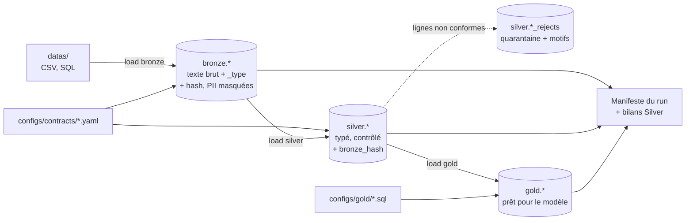

# Guide pas à pas : charger les couches Bronze, Silver et Gold dans PostgreSQL

> **Mise à jour du 26/11/2026 : Bronze v2.** Le Bronze a été réaligné sur les consignes du
> formateur : colonnes `x_raw` + `x` typé, colonnes techniques, rejeu sans doublon, registre des
> lots, pseudonymisation déplacée au **Silver**. Les parties de ce guide qui décrivent le Bronze
> (1.4, 2.2, 6.3, partie Bronze de 6.7, 9.1, 9.3) sont **remplacées** par
> [08_bronze_contrat_v2.md](08_bronze_contrat_v2.md). Les questions 2 et 3 de la partie 12 sont
> tranchées par ces consignes.

**Projet InduSense, Sprint 1.** Le pipeline charge les données dans les trois couches de
l'architecture médaillon, chacune dans son schéma PostgreSQL :

- **Bronze** : les fichiers bruts de `datas/`, une table par fichier, avec le type de chaque
  colonne, une empreinte par ligne et les données de l'opérateur pseudonymisées ;
- **Silver** : les mêmes données, typées et contrôlées selon les contrats ; les lignes non
  conformes partent en quarantaine, avec leur motif ;
- **Gold** : les jeux prêts pour le modèle, définis par des requêtes SQL sur le Silver.

Compétences mobilisées : **C2** (données personnelles, RGPD), **C3** (intégrité, préparation et
traçabilité des données).

> **Lien avec la consigne du jour.** La consigne demande d'« ingérer les données brutes dans le
> Gold dataset » avec, pour chaque colonne, son type, une colonne `hash` et l'opérateur anonymisé.
> Dans l'architecture médaillon, une copie fidèle des données brutes correspond à la couche
> **Bronze** : c'est donc là que ces exigences sont réalisées (parties 6.3 et 8). Le Silver et le
> Gold complètent la chaîne. Si le formateur tient au nom `gold` pour ce premier maillon, les noms
> des schémas se changent en une ligne de configuration (partie 5).

> **Comment lire ce guide.** Les parties 1 et 2 expliquent les notions et les choix : lisez-les
> avant de toucher au clavier, c'est ce que le jury vous demandera de justifier. Les parties 3 à 9
> sont la procédure, à suivre dans l'ordre. Chaque bloc de code est expliqué en français juste
> au-dessus. La partie 11 rassemble les erreurs fréquentes et leur solution.

---

## Sommaire

0. [Ce que vous allez obtenir](#0-ce-que-vous-allez-obtenir)
1. [Comprendre les notions](#1-comprendre-les-notions)
2. [Les décisions de conception](#2-les-décisions-de-conception)
3. [Préparer l'environnement : Docker, `.env`, PostgreSQL](#3-préparer-lenvironnement)
4. [Récupérer la branche et installer les dépendances](#4-récupérer-la-branche-et-installer-les-dépendances)
5. [La configuration](#5-la-configuration)
6. [Le code, fichier par fichier](#6-le-code-fichier-par-fichier)
7. [Les tests](#7-les-tests)
8. [Charger les couches](#8-charger-les-couches)
9. [Vérifier le résultat](#9-vérifier-le-résultat)
10. [Tracer dans le journal de bord, puis fusionner](#10-tracer-dans-le-journal-de-bord-puis-fusionner)
11. [Dépannage](#11-dépannage)
12. [Questions à valider avec le formateur](#12-questions-à-valider-avec-le-formateur)
13. [Glossaire](#13-glossaire)

---

## 0. Ce que vous allez obtenir



Une commande par couche, ou une seule pour les trois :

```bash
uv run indusense load bronze     # datas/ -> bronze.*
uv run indusense load silver     # bronze.* -> silver.* (+ quarantaine, bilans)
uv run indusense load gold       # configs/gold/*.sql -> gold.*
uv run indusense load all        # les trois, dans l'ordre
```

| Couche | Tables (vos données) | Contenu |
|---|---|---|
| Bronze | `bronze.releves_incidents` (1 245 lignes), `bronze.telemetry` (135 626), `bronze.machine` (15), `bronze.maintenance` (115) | valeurs à l'identique, en texte ; `x_type` après chaque colonne `x` ; `hash` en dernier |
| Silver | mêmes noms dans `silver`, plus `silver.<jeu>_rejects` | vrais types (nombres, dates, heures, booléens) ; `operator_name` retiré ; `bronze_hash` |
| Gold | une table par requête de `configs/gold/` | vide tant qu'aucune requête n'est définie (un modèle est fourni) |

Exemple d'une ligne Bronze (extrait) :

| incident_id | incident_id_type | operator_name | operator_name_type | severity | severity_type | hash |
|---|---|---|---|---|---|---|
| INC-000001 | IDENTITY | a64cbe96…b9ed78 | CATEGORY | 4 | INTEGER | 9302b4a5…2f80a7 |

La même ligne au Silver : `severity` est un entier (`4`), `date` une vraie date, `time` une
heure ; `operator_name` a disparu (contrat : `privacy: drop`), `operator_badge` reste sous forme
de pseudonyme ; `bronze_hash` vaut `9302b4a5…2f80a7`, l'empreinte de la ligne Bronze d'origine.

---

## 1. Comprendre les notions

### 1.1 Docker et `docker compose`

Depuis 2007, la façon d'installer un serveur a beaucoup changé. Au lieu d'installer PostgreSQL
sur votre poste, on le fait tourner dans un **conteneur** : une petite machine isolée, créée
à partir d'une **image** (un modèle prêt à l'emploi, ici `postgres:15.1`).

| Notion | Analogie | Dans notre fichier |
|---|---|---|
| Image | le CD d'installation | `postgres:15.1`, `dpage/pgadmin4:6.15` |
| Conteneur | le logiciel installé qui tourne | les services `db` et `admin` |
| Volume | le disque dur du conteneur, conservé quand on l'arrête | `pg-db-data` |
| Port publié | une prise entre votre poste et le conteneur | `127.0.0.1:5434 → 5432` |
| `docker-compose.yml` | la liste des logiciels à démarrer ensemble et leurs réglages | fourni par le formateur |
| `.env` | les valeurs propres à votre poste (ports, mots de passe) | à créer depuis `env.sample` |

`docker compose` lit `docker-compose.yml`, remplace les `${DB_PORT:-5432}` par les valeurs du
`.env` (ou par la valeur après `:-` si la variable est absente), puis démarre les conteneurs.

### 1.2 PostgreSQL, schéma, table

PostgreSQL est un serveur de base de données relationnelle. Une **base** (`indusense_db`)
contient des **schémas** (des dossiers de tables) qui contiennent des **tables**. Chaque couche a
son schéma : `bronze`, `silver`, `gold`. On voit ainsi d'un coup d'œil d'où vient une table.

**pgAdmin** est l'interface web qui permet de voir les tables et de lancer des requêtes SQL.

### 1.3 Les trois couches et leur règle d'or

| Couche | Question à laquelle elle répond | Ce qu'on y fait | Ce qu'on n'y fait **pas** |
|---|---|---|---|
| **Bronze** | « Qu'a-t-on reçu exactement ? » | recopier, typer pour information, tracer, protéger les données personnelles | corriger, filtrer, convertir |
| **Silver** | « Quelles données sont fiables ? » | convertir vers les types du contrat, appliquer ses règles, écarter ce qui n'est pas conforme | deviner une valeur, supprimer une valeur extrême plausible |
| **Gold** | « Que donne-t-on au modèle ? » | joindre, agréger, construire la cible | revenir aux fichiers bruts |

Chaque couche **ne lit que la précédente**. On peut donc rejouer le Silver (après avoir corrigé
un contrat, par exemple) sans relire les fichiers, et le Gold sans refaire le Silver.

### 1.4 Empreinte (hash) SHA-256

Une fonction de hachage transforme n'importe quel texte en une suite de 64 caractères :

```
"MACH-01,22.5" -> 59ed2c07dca5b9ecfee7e2f740e09dcf5bcad5986ec2add396537ab314200c94
"MACH-01,22.6" -> a232103e439d289dceaeb9f0ba492dd8e54679e72e94e5f1821b7c7d2ebe3e3d
                  (un seul caractère modifié : toute l'empreinte change)
```

Trois propriétés nous intéressent :

1. **Déterministe** : le même texte donne toujours la même empreinte.
2. **Sensible** : un seul caractère différent change toute l'empreinte.
3. **Sens unique** : on ne peut pas retrouver le texte à partir de l'empreinte.

Au Bronze, elle sert de **preuve d'intégrité** : si l'empreinte recalculée d'une ligne ne
correspond plus à la colonne `hash`, la ligne a été modifiée. Au Silver, elle devient un
**lien de lignage** (`bronze_hash`) : de n'importe quelle ligne Silver, on retrouve sa ligne Bronze.

### 1.5 Pourquoi un sel pour les données personnelles

Le « sens unique » a une faille. Si l'on hache simplement `"Martin Dupont"`, quelqu'un qui
connaît la liste des opérateurs de l'usine peut hacher chaque nom et comparer : c'est une
**attaque par dictionnaire**. Avec quelques dizaines d'opérateurs, elle prend une fraction de
seconde.

Le **sel** est une valeur secrète mélangée au nom avant le hachage. Sans le sel, l'attaquant ne
peut plus refaire le calcul. Nous utilisons **HMAC-SHA256**, la façon standard de combiner un
secret et SHA-256 (c'est bien « SHA-256 + sel », mais sous une forme éprouvée plutôt
qu'une simple concaténation).

Deux règles découlent de cette logique :

- le sel est un **secret** : il va dans `.env` (jamais versionné), pas dans le code ni dans Git ;
- le sel doit **rester le même** d'une exécution à l'autre : s'il change, les empreintes
  changent, et on ne peut plus relier les incidents d'un même opérateur entre deux chargements.

### 1.6 Pseudonymisation n'est pas anonymisation (point C2)

Au sens du RGPD :

- **pseudonymisation** : on remplace l'identité par un code ; celui qui détient la clé (ici le
  sel) peut refaire le lien. Les données **restent des données personnelles** ;
- **anonymisation** : le lien est impossible à refaire, pour quiconque. Les données sortent du
  champ du RGPD.

Un hash salé est une **pseudonymisation**. La consigne dit « anonymiser » : dans votre dossier,
employez le terme exact. C'est le genre de précision qu'un jury C2 apprécie.

### 1.7 Quarantaine plutôt que correction

Au Silver, une ligne qui enfreint une règle bloquante du contrat (gravité `9` alors que l'échelle
va de 1 à 5, équipe `Matin` alors que la liste autorisée est `matin`, `apres-midi`, `nuit`) n'est
ni corrigée ni supprimée : elle est **mise en quarantaine** dans `silver.<jeu>_rejects`, avec le
motif (`severity:max`, `shift:allowed_values`). On sait ainsi exactement ce qui manque au Silver
et pourquoi, et on peut en discuter avec le métier. Corriger `Matin` en `matin` serait une
décision métier : elle se prend explicitement (dans le contrat), pas dans le code.

### 1.8 Transaction et idempotence

- Une **transaction** regroupe plusieurs opérations SQL en un bloc : soit tout réussit, soit
  rien n'est enregistré. Si le chargement plante à la ligne 80 000, la table précédente reste
  intacte.
- Une opération **idempotente** donne le même résultat quel que soit le nombre de fois où on la
  lance. Ici, chaque chargement supprime et recrée la table : relancer ne crée pas de doublons.

---

## 2. Les décisions de conception

À recopier et justifier dans votre journal de bord : c'est ce qui est évalué.

### 2.1 Communes aux trois couches

| # | Question | Décision | Justification |
|---|---|---|---|
| D1 | CSV ou PostgreSQL ? | **PostgreSQL**, un schéma par couche (`bronze`, `silver`, `gold`), une table par jeu de données | Le `docker-compose.yml` est fourni. Un script SQL contenant deux tables donne deux tables. |
| D2 | Mode de chargement | **Recharge complète** (suppression, création, insertion) de chaque table dans **une transaction** | Idempotent et sans risque de table à moitié chargée. Suffisant pour ces volumes (environ 15 secondes pour tout). |
| D3 | Où sont les secrets ? | Dans `.env`, lu par `pydantic-settings` ; les réglages non secrets dans `configs/pipeline.yaml` | `.env` est déjà dans `.gitignore`. C'est ce que prévoit `env.sample`. |
| D4 | Jeu de données sans contrat ? | **Refusé** (message d'erreur, code retour 1) | Sans contrat, on ne sait ni quelles colonnes protéger ni quels types attendre : protection des données dès la conception. |
| D5 | Traçabilité | Commentaire SQL sur chaque table (origine, run) + manifeste `artifacts/ingestion/runs/<run>/manifest.json` + bilan Silver par jeu | On sait toujours quelle version de quel fichier, et quel contrat, ont produit une table. |

### 2.2 Bronze

| # | Question | Décision | Justification |
|---|---|---|---|
| B1 | Format des valeurs | Tout en **texte** (`TEXT`), recopié tel que lu | Consigne « à l'identique » : aucune conversion (`6,5` reste `6,5`, une date ambiguë n'est pas réinterprétée). |
| B2 | D'où vient le type ? | Le **type inféré** par le module existant (le même que dans les cartes d'identité) : `IDENTITY`, `INTEGER`, `FLOAT`, `DATETIME`, `TIME`, `BOOLEAN`, `CATEGORY`, `TEXT`, `EMPTY` | Le Bronze décrit ce qui a été **observé** ; le Silver appliquera ce qui est **attendu** (le contrat). |
| B3 | Nom de la colonne de type | `<colonne>_type`, placée juste après la colonne | Consigne « une colonne en plus déterminant le type de la colonne qui précède ». Suffixe réglable. |
| B4 | Quelles colonnes pseudonymiser ? | Celles que le **contrat** marque `pii: true` avec `privacy: pseudonymize` ou `drop` : `operator_name` et `operator_badge` | Aucun nom de colonne dans le code. `drop` est pseudonymisé car le Bronze garde toutes les colonnes ; la suppression se fait au Silver. |
| B5 | Et le commentaire libre ? | **Laissé en clair, avec un avertissement à chaque exécution** (`privacy: to_decide`) | Un texte libre peut contenir des noms. Le hacher le rendrait inutilisable, le garder expose un risque : la décision appartient au métier et au formateur (partie 12). |
| B6 | Sur quoi calculer `hash` ? | Sur les **colonnes sources, dans leur ordre, telles que stockées** (donc après pseudonymisation), hors colonnes `_type` | Calculée sur le nom en clair et sans sel, l'empreinte permettrait de tester « Martin Dupont était-il dans cet incident ? ». Calculée ainsi, elle se vérifie en relisant la table. L'empreinte du fichier brut est dans le manifeste. |
| B7 | Assemblage des valeurs avant hachage | En **liste JSON** : `["INC-000001","a64c…","4"]` | Une concaténation avec une virgule est ambiguë : `"a,b" + "c"` et `"a" + "b,c"` donneraient la même chaîne. |

### 2.3 Silver

| # | Question | Décision | Justification |
|---|---|---|---|
| S1 | Source | Les tables **Bronze**, jamais les fichiers | Une seule lecture des fichiers ; le Silver se rejoue seul. |
| S2 | Types | Ceux du **contrat** : `INTEGER` → `BIGINT`, `FLOAT` → `DOUBLE PRECISION`, `DATETIME` → `TIMESTAMP` (ou `TIMESTAMPTZ` si les valeurs ou le type déclaré ont un fuseau), `TIME` → `TIME`, `BOOLEAN` → `BOOLEAN`, le reste → `TEXT` | Le contrat est l'attendu, validé par une décision ; l'inférence n'est qu'une observation. |
| S3 | Valeurs manquantes | Espaces retirés, puis jetons `na_tokens` de la config (`""`, `NA`, `null`, `-`…) → `NULL` | Une seule façon de dire « absent ». |
| S4 | Doublons exacts | Même empreinte Bronze → **une seule ligne gardée**, nombre retiré indiqué dans le bilan | Une ligne strictement identique n'apporte aucune information. |
| S5 | Ligne qui enfreint une règle bloquante | **Quarantaine** dans `silver.<jeu>_rejects`, valeurs en texte et motifs `colonne:règle`. Clé primaire en double entre lignes valides : **toutes** les lignes en conflit partent en quarantaine | Ni correction ni perte silencieuse (partie 1.7) : rien ne permet de dire laquelle de deux mesures contradictoires est la bonne. Règles : obligatoire, type, format, liste de valeurs, bornes, unicité, clé primaire. |
| S6 | Règle en `on_fail: warning` | Ligne conservée ; une valeur non convertible devient `NULL` ; tout est compté dans le bilan | C'est la sévérité choisie dans le contrat. |
| S7 | Colonnes `privacy: drop` et colonnes absentes du contrat | **Retirées** du Silver (signalées) | Minimisation RGPD ; le Silver respecte le schéma du contrat. |
| S8 | Colonnes pseudonymisées | Gardées sous forme de pseudonyme, **sans contrôle de format ni de liste** | Leurs valeurs sont des empreintes : `^OP\d{4}$` ne peut plus correspondre. |
| S9 | Valeurs extrêmes dans les bornes | **Conservées** | En maintenance prédictive, l'extrême est souvent le signal recherché. |
| S10 | Lignage | Colonne `bronze_hash` sur chaque ligne Silver et en quarantaine | De toute ligne Silver, on remonte à la ligne Bronze, donc au fichier. |

### 2.4 Gold

| # | Question | Décision | Justification |
|---|---|---|---|
| G1 | Comment définir un jeu Gold ? | Un fichier `configs/gold/<nom>.sql` contenant **une** requête `SELECT` (ou `WITH`) sur le Silver → table `gold.<nom>` | Les choix métier (jointures, cible) sont écrits en SQL lisible, versionnés et relus, pas cachés dans du Python. |
| G2 | Contrôles | Nom de table en minuscules, une seule requête, qui commence par `SELECT`/`WITH` | Un fichier Gold ne doit pas pouvoir modifier ou supprimer des données. |
| G3 | Contenu aujourd'hui | **Aucune requête active** ; un modèle `incidents_par_machine_jour.sql.example` est fourni | La définition du jeu d'entraînement (cible, fenêtre) dépend de la consigne suivante et du métier. |

---

## 3. Préparer l'environnement

### 3.1 Installer Docker Desktop

1. Téléchargez **Docker Desktop** depuis le site officiel de Docker et installez-le
   (sous Windows, acceptez l'option WSL 2 proposée).
2. Lancez Docker Desktop et attendez que l'icône indique que le moteur tourne.
3. Dans un terminal VS Code (*Terminal > New Terminal*), vérifiez :

```bash
docker --version
docker compose version
```

Les deux commandes doivent afficher un numéro de version.

### 3.2 Les fichiers fournis

Ils sont déjà sur la branche (partie 4) : `docker-compose.yml` et `.env.sample` (le fichier
`env.sample` renommé) à la racine du projet. Il vous reste à créer **votre** `.env`, qui ne sera
jamais versionné :

```text
indusense/
├── docker-compose.yml      ← fichier fourni, tel quel
├── .env.sample             ← modèle, versionné dans Git
├── .env                    ← votre copie personnelle, JAMAIS versionnée
└── ...
```

```bash
# macOS / Linux / Git Bash
cp .env.sample .env
```

```powershell
# PowerShell (Windows)
Copy-Item .env.sample .env
```

Vérifiez que Git ignore bien `.env` (la ligne `.env` est déjà dans votre `.gitignore`) :

```bash
git check-ignore .env      # doit afficher : .env
```

### 3.3 Adapter le `.env`

Ouvrez `.env` dans VS Code et modifiez ces lignes. Les autres peuvent rester telles quelles.

| Variable | Valeur du modèle | À faire |
|---|---|---|
| `DB_PORT` | `5434` | Gardez `5434`, sauf si ce port est déjà pris sur votre poste. |
| `DB_PASSWORD` | `ThePassword4Indusense` | Mettez votre propre mot de passe (lettres et chiffres, c'est plus simple). |
| `GUI_EMAIL` | `mylogin@mydomain.org` | Votre identifiant pgAdmin : une adresse au format e-mail. |
| `GUI_PASSWORD` | `mypassword` | Votre mot de passe pgAdmin. |
| `GUI_PORT` | `8081` | Gardez `8081`. |
| `ANONYMISATION_SALT` | `dev-salt-indusense-change-me` | **À remplacer** par une valeur aléatoire (ci-dessous). |

Générez un sel aléatoire avec Python et collez le résultat après `ANONYMISATION_SALT=` :

```bash
uv run python -c "import secrets; print(secrets.token_hex(32))"
```

> ⚠️ **Le mot de passe de la base est fixé au premier démarrage.** PostgreSQL lit
> `DB_PASSWORD` uniquement lors de la création du volume. Si vous le changez après, l'ancien
> reste actif et la connexion échoue. Choisissez-le **avant** la première commande ci-dessous
> (sinon, voir la partie 11).

> ⚠️ **Le sel est un secret durable.** Conservez-le (gestionnaire de mots de passe, par exemple).
> Le perdre ou le changer rend les pseudonymes incomparables d'un chargement à l'autre.

### 3.4 Démarrer PostgreSQL et pgAdmin uniquement

Le fichier fourni contient aussi Prometheus, Alertmanager et Grafana, qui ne servent pas encore
et attendent un dossier `monitoring/` que vous n'avez pas. On démarre donc **seulement** les deux
services utiles :

```bash
docker compose up -d db admin
```

- `up` : crée et démarre les conteneurs ;
- `-d` : en arrière-plan (le terminal reste disponible) ;
- `db admin` : seulement ces deux services.

Au premier lancement, Docker télécharge les images (quelques minutes). Vérifiez ensuite :

```bash
docker compose ps
```

La colonne `STATUS` de `db` doit afficher `Up … (healthy)`. Le `healthcheck` du fichier vérifie
toutes les deux secondes que PostgreSQL accepte les connexions ; pgAdmin attend cet état pour
démarrer.

| Commande | Effet |
|---|---|
| `docker compose ps` | état des conteneurs |
| `docker compose logs db` | journal de PostgreSQL (en cas de problème) |
| `docker compose stop` | arrête les conteneurs, **les données sont conservées** |
| `docker compose start db admin` | les redémarre |
| `docker compose down` | supprime les conteneurs, **les volumes (données) restent** |
| `docker compose down -v` | supprime aussi les volumes : **toutes les données sont effacées** |

### 3.5 Se connecter avec pgAdmin

1. Ouvrez <http://127.0.0.1:8081> et connectez-vous avec `GUI_EMAIL` / `GUI_PASSWORD`.
2. Clic droit sur **Servers > Register > Server…**
3. Onglet **General** : *Name* = `indusense` (libre).
4. Onglet **Connection** :

| Champ | Valeur | Pourquoi |
|---|---|---|
| Host name/address | **`db`** | pgAdmin tourne **dans** Docker : il joint la base par le nom du service, pas par `localhost`. |
| Port | **`5432`** | le port **interne** au réseau Docker (5434 n'existe que côté votre poste). |
| Maintenance database | `indusense_db` | `DB_NAME` |
| Username | `indusense_user` | `DB_USER` |
| Password | votre `DB_PASSWORD` | |

> Retenez la différence, c'est le piège le plus courant : **depuis votre poste** (Python, le
> notebook), on se connecte à `127.0.0.1:5434` ; **depuis un autre conteneur** (pgAdmin), à `db:5432`.

---

## 4. Récupérer la branche et installer les dépendances

Le code est dans la branche **`feat/medallion-layers`**, découpée en six commits (un par étape),
partie de votre `main` actuel. Elle vous est livrée dans le fichier
**`feat-medallion-layers.bundle`** : un *bundle* Git est un fichier qui contient des commits, que
Git sait importer comme s'ils venaient de GitHub. Enregistrez-le, par exemple dans votre dossier
Téléchargements, puis, depuis la racine du projet :

```bash
git checkout main
git pull                                            # main à jour
git fetch ~/Downloads/feat-medallion-layers.bundle feat/medallion-layers:feat/medallion-layers
git checkout feat/medallion-layers                  # vous êtes sur la branche importée
git log --oneline main..feat/medallion-layers       # les six commits
uv sync                                             # installe les nouvelles dépendances
git push -u origin feat/medallion-layers            # publie la branche sur GitHub
```

Adaptez le chemin du bundle à l'endroit où vous l'avez enregistré (sous Windows, par exemple
`C:/Users/<vous>/Downloads/feat-medallion-layers.bundle`, avec des `/`). Une fois la branche
publiée, vous pouvez la relire sur GitHub (onglet *Branches*, ou bouton *Compare & pull request*)
avant de la fusionner (partie 10.2). `main` n'est pas modifié tant que vous ne fusionnez pas.

Trois bibliothèques ont été ajoutées (commande utilisée : `uv add sqlalchemy "psycopg[binary]" pydantic-settings`) :

| Bibliothèque | Rôle |
|---|---|
| `sqlalchemy` | décrit les tables en Python et dialogue avec la base (référence en Python, utilisée aussi par Alembic plus tard) |
| `psycopg[binary]` | le « pilote » qui parle réellement à PostgreSQL ; `[binary]` évite d'installer quoi que ce soit d'autre sur votre poste |
| `pydantic-settings` | lit le `.env` et vérifie les valeurs (un port doit être un nombre, par exemple) |

Les trois proposent des versions compatibles Python 3.15.

---

## 5. La configuration

Votre `CLAUDE.md` impose qu'aucun réglage ne soit écrit en dur dans le code. Deux ajouts dans
`configs/pipeline.yaml`.

Dans la section `paths:`, le dossier des bilans :

```yaml
  layers: layers                # bilans du chargement des couches (bronze, silver, gold)
```

À la fin du fichier, la section des couches :

```yaml
# -----------------------------------------------------------------------------
# Couches de l'architecture médaillon dans PostgreSQL (commande `indusense load`)
# Les SECRETS (mot de passe, sel de pseudonymisation) sont dans .env, jamais ici.
# -----------------------------------------------------------------------------
layers:
  schemas: {bronze: bronze, silver: silver, gold: gold}
  chunk_size: 5000              # lignes envoyées par lot à PostgreSQL

  # BRONZE : une table par jeu de données. Pour chaque colonne source `x` :
  #   x (valeur brute, en texte) puis x<type_suffix> (type inféré), puis la colonne d'empreinte.
  bronze:
    type_suffix: _type
    hash_column: hash
    # Colonnes `pii: true` des contrats pseudonymisées (HMAC-SHA256 + sel) selon leur `privacy`.
    # `drop` est inclus : le Bronze garde TOUTES les colonnes, une colonne à supprimer y est donc
    # au minimum pseudonymisée ; elle est retirée au Silver.
    # `to_decide` n'est PAS inclus : la colonne reste en clair et un avertissement est affiché.
    pseudonymize_privacy: [pseudonymize, drop]

  # SILVER : typé et contrôlé selon les contrats ; lignes invalides en quarantaine.
  silver:
    lineage_column: bronze_hash   # empreinte de la ligne Bronze d'origine
    rejects_suffix: _rejects      # silver.<jeu>_rejects : lignes en quarantaine
    reasons_column: reject_reasons

  # GOLD : une table par fichier <nom>.sql (une requête SELECT sur le Silver).
  gold:
    queries_dir: configs/gold
```

À retenir :

- `schemas` : le nom du schéma de chaque couche (c'est ici qu'on renommerait `bronze` en `gold`
  si le formateur le demandait) ;
- `bronze.pseudonymize_privacy` : les valeurs de `privacy` (dans les contrats) qui déclenchent la
  pseudonymisation (décisions B4 et B5) ;
- `silver` : les noms des colonnes et tables techniques ajoutées ;
- `gold.queries_dir` : le dossier des requêtes Gold ;
- `chunk_size` : les lignes sont envoyées à PostgreSQL par paquets de 5 000 (la télémétrie en compte
  135 000).

Rien à changer dans vos contrats : ce sont eux qui portent les règles du Silver (`type`,
`required`, `pattern`, `allowed_values`, `min`, `max`, `unique`, `primary_key`, `on_fail`,
`pii`, `privacy`). **Améliorer le Silver, c'est donc améliorer les contrats.**

`src/indusense/config.py` reçoit une seule modification, pour connaître ce nouveau dossier :

```python
        subdirs={**{k: paths[k] for k in ("identities", "audits", "validations", "drafts", "runs")},
                 "layers": paths.get("layers", "layers")},   # bilans des couches (facultatif)
```

---

## 6. Le code, fichier par fichier

Le code est dans un nouveau dossier `src/indusense/layers/`. Chaque fichier a **une seule
responsabilité** :

| Fichier | Responsabilité | A besoin de la base ? |
|---|---|---|
| `__init__.py` | présente le sous-paquet | non |
| `settings.py` | lit la section `layers:` de la configuration | non |
| `anonymize.py` | pseudonymiser une valeur ; trouver les colonnes concernées dans le contrat | non |
| `bronze.py` | construire une table Bronze en mémoire : colonnes, types, empreinte | non |
| `silver.py` | construire une table Silver, sa quarantaine et son bilan à partir du Bronze | non |
| `gold.py` | lire et contrôler les requêtes Gold | non |
| `database.py` | lire le `.env`, se connecter, lire et (re)charger des tables | **oui** |
| `stage.py` | enchaîner bronze → silver → gold et écrire le manifeste | oui |

Séparer ce qui touche la base du reste permet de **tester toute la logique sans PostgreSQL**
(partie 7). La lecture des fichiers et l'inférence de types existent déjà dans le projet
(`load_and_profile`) ; le Silver réutilise les fonctions de conversion de `profiling/types.py`.
Rien n'est recopié.

> **Avec votre agent IA.** Pour apprendre, ouvrez chaque fichier dans VS Code à côté de son
> explication ci-dessous, et demandez à l'agent de vous commenter les lignes que vous ne
> comprenez pas. À l'examen, c'est vous qui devez expliquer le code.

### 6.1 `__init__.py` et `settings.py`

`settings.py` transforme la section `layers:` du YAML en un objet Python figé (`frozen=True` : il
ne peut pas être modifié par erreur en cours d'exécution). Chaque réglage a une valeur par défaut,
utilisée si la clé est absente.

```python
"""Chargement des couches de l'architecture médaillon dans PostgreSQL.

    bronze : copie fidèle des sources (texte brut) + type inféré par colonne + empreinte de ligne,
             données personnelles pseudonymisées ;
    silver : données typées et contrôlées selon les contrats (lignes invalides en quarantaine) ;
    gold   : jeux prêts pour l'usage, définis par des requêtes SQL (configs/gold/*.sql).
"""
```

```python
"""Réglages des couches : section `layers:` de configs/pipeline.yaml (aucun secret ici)."""
from __future__ import annotations

from dataclasses import dataclass
from pathlib import Path


@dataclass(frozen=True)
class LayerSettings:
    bronze_schema: str = "bronze"
    silver_schema: str = "silver"
    gold_schema: str = "gold"
    type_suffix: str = "_type"               # bronze : x -> x_type
    hash_column: str = "hash"                # bronze : empreinte de la ligne
    pseudonymize_privacy: tuple[str, ...] = ("pseudonymize",)
    lineage_column: str = "bronze_hash"      # silver : lien vers la ligne bronze d'origine
    rejects_suffix: str = "_rejects"         # silver : table de quarantaine
    reasons_column: str = "reject_reasons"   # silver : motifs de rejet
    gold_queries_dir: Path = Path("configs/gold")
    chunk_size: int = 5000

    @classmethod
    def from_raw(cls, raw: dict, root: Path) -> "LayerSettings":
        """Lit la section `layers:` ; les clés absentes prennent la valeur par défaut."""
        g = raw.get("layers") or {}
        schemas = g.get("schemas") or {}
        bronze, silver, gold = (g.get(k) or {} for k in ("bronze", "silver", "gold"))
        qdir = Path(gold.get("queries_dir", cls.gold_queries_dir))
        return cls(
            bronze_schema=schemas.get("bronze", cls.bronze_schema),
            silver_schema=schemas.get("silver", cls.silver_schema),
            gold_schema=schemas.get("gold", cls.gold_schema),
            type_suffix=bronze.get("type_suffix", cls.type_suffix),
            hash_column=bronze.get("hash_column", cls.hash_column),
            pseudonymize_privacy=tuple(bronze.get("pseudonymize_privacy", cls.pseudonymize_privacy)),
            lineage_column=silver.get("lineage_column", cls.lineage_column),
            rejects_suffix=silver.get("rejects_suffix", cls.rejects_suffix),
            reasons_column=silver.get("reasons_column", cls.reasons_column),
            gold_queries_dir=qdir if qdir.is_absolute() else root / qdir,
            chunk_size=int(g.get("chunk_size", cls.chunk_size)),
        )
```

### 6.2 `anonymize.py`

- `pseudonymize` : calcule l'empreinte HMAC-SHA256 d'une valeur avec le sel. Une cellule vide
  reste vide (sinon toutes les cellules vides auraient la même empreinte, ce qui ferait croire
  à un opérateur fantôme).
- `pseudonymize_series` : applique la fonction à toute une colonne, en calculant une seule fois
  par valeur distincte (3 opérateurs → 3 calculs, et non 1 245).
- `columns_to_pseudonymize` : lit le contrat et renvoie les colonnes à protéger.
- `undecided_pii_columns` : renvoie les colonnes personnelles qui resteront en clair, pour les
  signaler.

```python
"""Pseudonymisation des données personnelles : SHA-256 avec un sel secret.

On utilise HMAC-SHA256, la façon standard d'« ajouter un sel secret » à SHA-256 :
- même valeur + même sel  -> même empreinte (on peut encore compter ou regrouper par opérateur) ;
- sans le sel, impossible de retrouver le nom en essayant une liste de noms connus.

Au sens du RGPD, c'est une PSEUDONYMISATION (le détenteur du sel pourrait refaire le lien),
pas une anonymisation complète : les tables restent des données personnelles à protéger.
"""
from __future__ import annotations

import hashlib
import hmac

import pandas as pd


def pseudonymize(value: str, salt: str) -> str:
    """Empreinte HMAC-SHA256 (64 caractères hexadécimaux) d'une valeur ; vide reste vide."""
    if value == "":
        return ""
    return hmac.new(salt.encode("utf-8"), value.encode("utf-8"), hashlib.sha256).hexdigest()


def pseudonymize_series(values: pd.Series, salt: str) -> pd.Series:
    """Applique `pseudonymize` à une colonne (calcul fait une seule fois par valeur distincte)."""
    mapping = {v: pseudonymize(v, salt) for v in values.unique()}
    return values.map(mapping)


def columns_to_pseudonymize(contract: dict, privacy_actions: tuple[str, ...]) -> list[str]:
    """Colonnes du contrat marquées `pii: true` dont l'action `privacy` est dans la liste."""
    return [c["name"] for c in contract.get("schema", {}).get("columns", [])
            if c.get("pii") and c.get("privacy") in privacy_actions]


def undecided_pii_columns(contract: dict, privacy_actions: tuple[str, ...]) -> list[str]:
    """Colonnes personnelles qui resteront en clair : à signaler, la décision reste humaine."""
    return [c["name"] for c in contract.get("schema", {}).get("columns", [])
            if c.get("pii") and c.get("privacy") not in privacy_actions]
```

### 6.3 `bronze.py` — les exigences de la consigne

- `type_column` : `severity` → `severity_type`.
- `source_columns` : l'opération inverse, utile au Silver : retrouver les colonnes sources d'une
  table Bronze.
- `name_errors` : refuse les cas où un nom entrerait en collision (une source qui aurait déjà
  une colonne `hash` ou `x_type`) ou dépasserait la limite de 63 caractères de PostgreSQL.
- `row_hash` / `hash_rows` : empreinte d'une ligne / de chaque ligne (décision B7).
- `build_bronze_frame` : pseudonymise sur une **copie** (la source n'est jamais modifiée),
  intercale chaque colonne et son type, ajoute l'empreinte à la fin.

```python
"""Couche Bronze : construction de la table en mémoire (pandas), sans base de données.

Pour chaque colonne source `x` : `x` (valeur brute, en texte, identique à la source,
sauf pseudonymisation) puis `x<suffixe>` (type inféré de `x`). En dernier : la colonne
d'empreinte de la ligne. Tout est séparé de la base pour pouvoir être testé seul.
"""
from __future__ import annotations

import hashlib
import json

import pandas as pd

from indusense.layers.anonymize import pseudonymize_series
from indusense.layers.settings import LayerSettings

PG_MAX_IDENTIFIER = 63      # longueur maximale d'un nom de colonne PostgreSQL


def type_column(name: str, cfg: LayerSettings) -> str:
    """Nom de la colonne de type associée à une colonne source."""
    return f"{name}{cfg.type_suffix}"


def source_columns(bronze_columns: list[str], cfg: LayerSettings) -> list[str]:
    """Colonnes sources d'une table Bronze (sans les colonnes de type ni l'empreinte)."""
    types = {type_column(c, cfg) for c in bronze_columns}
    return [c for c in bronze_columns if c not in types and c != cfg.hash_column]


def name_errors(columns: list[str], cfg: LayerSettings) -> list[str]:
    """Collisions de noms ou noms trop longs : on refuse plutôt que d'écraser une colonne."""
    errors = []
    bronze = [c for name in columns for c in (name, type_column(name, cfg))] + [cfg.hash_column]
    duplicates = sorted({c for c in bronze if bronze.count(c) > 1})
    if duplicates:
        errors.append(f"noms de colonnes en collision : {duplicates}")
    too_long = [c for c in bronze if len(c) > PG_MAX_IDENTIFIER]
    if too_long:
        errors.append(f"noms de plus de {PG_MAX_IDENTIFIER} caractères : {too_long}")
    return errors


def row_hash(values: list[str]) -> str:
    """Empreinte SHA-256 d'une ligne.

    Les valeurs sont encodées en liste JSON : ["a,b", "c"] et ["a", "b,c"] donnent des
    textes différents, donc des empreintes différentes (une simple concaténation avec une
    virgule les confondrait).
    """
    canonical = json.dumps(values, ensure_ascii=False, separators=(",", ":"))
    return hashlib.sha256(canonical.encode("utf-8")).hexdigest()


def hash_rows(df: pd.DataFrame) -> pd.Series:
    """Empreinte de chaque ligne, calculée sur les colonnes de `df` dans leur ordre."""
    return pd.Series([row_hash(list(r)) for r in df.itertuples(index=False, name=None)],
                     index=df.index, dtype=str)


def build_bronze_frame(raw: pd.DataFrame, types: dict[str, str], pii_columns: list[str],
                       salt: str, cfg: LayerSettings) -> pd.DataFrame:
    """Table Bronze : colonnes sources (pseudonymisées si besoin) + types + empreinte.

    L'empreinte est calculée APRÈS pseudonymisation : calculée sur le nom en clair et
    sans sel, elle permettrait de vérifier si « Martin Dupont » figure dans une ligne
    en essayant des noms, ce qui annulerait la protection.
    """
    source = raw.copy()
    for name in pii_columns:
        source[name] = pseudonymize_series(source[name], salt)
    bronze = pd.DataFrame(index=source.index)
    for name in source.columns:
        bronze[name] = source[name]
        bronze[type_column(name, cfg)] = types[name]
    bronze[cfg.hash_column] = hash_rows(source)
    return bronze
```

### 6.4 `silver.py` — typer et contrôler

Le cœur du Silver. Prenez le temps de le lire avec la docstring en tête de fichier, qui liste
les règles dans l'ordre où elles s'appliquent.

- `to_python` : convertit les valeurs pandas en objets Python que PostgreSQL comprend
  (`int`, `float`, `datetime`, `time`, `bool`, ou `None`).
- `sql_type` : choisit le type de colonne PostgreSQL (décision S2).
- `column_checks` : pour **une** colonne, renvoie les valeurs converties et, pour chaque règle du
  contrat, un « masque » : une suite de Vrai/Faux qui dit, ligne par ligne, si la règle est
  enfreinte. C'est la même logique que la commande `validate` existante, mais ligne par ligne
  au lieu d'un bilan global.
- `build_silver` : enchaîne les règles pour tout le jeu de données, répartit les lignes entre
  Silver et quarantaine, et prépare le bilan.
- `render_report` : écrit le bilan en Markdown (des faits, sans interprétation).

```python
"""Couche Silver : du Bronze (texte) vers des données typées et contrôlées par le contrat.

Règles, dans l'ordre, pour chaque jeu de données :
1. doublons exacts (même empreinte Bronze) : on garde la première ligne ;
2. espaces en début et fin retirés ; jetons de valeur manquante (`na_tokens`) -> NULL ;
3. conversion vers le type du CONTRAT (l'attendu), pas vers le type inféré ;
4. contrôles ligne à ligne : obligatoire, type, format, liste de valeurs, bornes, unicité, clé ;
   - règle en `on_fail: error` (défaut) : la ligne part en QUARANTAINE avec ses motifs ;
   - règle en `on_fail: warning` : la ligne reste ; une valeur non convertible devient NULL ;
5. colonnes `privacy: drop` retirées ; colonnes absentes du contrat retirées (signalées) ;
6. chaque ligne garde l'empreinte de sa ligne Bronze d'origine (lignage).

Rien n'est corrigé ni deviné : une valeur est convertie, ou mise de côté avec son motif.
Les valeurs extrêmes mais dans les bornes du contrat sont conservées (c'est souvent le signal).
"""
from __future__ import annotations

import re
from dataclasses import dataclass, field
from datetime import datetime

import pandas as pd
from sqlalchemy import BigInteger, Boolean, DateTime, Double, Text, Time

from indusense.config import InferenceSettings
from indusense.layers.bronze import source_columns
from indusense.layers.settings import LayerSettings
from indusense.profiling.types import convert, missing_mask

CONVERTIBLE = {"INTEGER", "FLOAT", "DATETIME", "TIME", "BOOLEAN"}


@dataclass
class SilverResult:
    dataset_id: str
    valid: pd.DataFrame                    # lignes conformes, valeurs typées
    rejects: pd.DataFrame                  # lignes en quarantaine (texte) + motifs
    column_types: dict[str, object]        # type SQL de chaque colonne de `valid`
    report: dict = field(default_factory=dict)


# ------------------------------------------------------------------ conversions
def to_python(values: pd.Series, col_type: str) -> pd.Series:
    """Valeurs converties -> objets Python que PostgreSQL comprend (None si manquant)."""
    def one(v):
        if pd.isna(v):
            return None
        if col_type == "INTEGER":
            return int(v)
        if col_type == "FLOAT":
            return float(v)
        if col_type == "BOOLEAN":
            return bool(v)
        if col_type == "DATETIME":
            return v.to_pydatetime()
        if col_type == "TIME":
            return (datetime.min + v).time()
        return v
    return values.map(one).astype(object)


def sql_type(col_type: str, converted: pd.Series | None = None, declared: str | None = None):
    """Type PostgreSQL d'un type logique.

    DATETIME -> TIMESTAMPTZ si les valeurs portent un fuseau, ou si le type SQL déclaré dans
    le contrat en prévoit un (utile quand la colonne est entièrement vide).
    """
    if col_type == "DATETIME":
        tz = converted is not None and getattr(converted.dt, "tz", None) is not None
        tz = tz or bool(declared and re.search(r"TZ|TIME ZONE", declared.upper()))
        return DateTime(timezone=tz)
    return {"INTEGER": BigInteger, "FLOAT": Double, "TIME": Time, "BOOLEAN": Boolean}.get(col_type, Text)


def _bound(value, col_type: str, converted: pd.Series):
    """Borne du contrat convertie comme les données (une date sans fuseau est lue en UTC
    si les données ont un fuseau, pour comparer des grandeurs homogènes)."""
    b = convert(pd.Series([str(value)]), col_type).iloc[0]
    tz = getattr(getattr(converted, "dt", None), "tz", None) if col_type == "DATETIME" else None
    if tz is not None and pd.notna(b) and b.tzinfo is None:
        b = b.tz_localize("UTC")
    return b


# ------------------------------------------------------------------ contrôles d'une colonne
def column_checks(spec: dict, raw: pd.Series, protected: bool,
                  inference: InferenceSettings) -> tuple[pd.Series | None, dict[str, pd.Series]]:
    """(valeurs converties ou None, {règle: masque des lignes en échec}).

    Une colonne pseudonymisée (`protected`) n'est pas contrôlée sur son format ni sur sa liste
    de valeurs : ses valeurs sont des empreintes, plus les valeurs d'origine.
    """
    ctype = spec["type"]
    miss = missing_mask(raw, inference)
    present = raw[~miss]
    none = pd.Series(False, index=raw.index)
    checks: dict[str, pd.Series] = {}
    if spec.get("required"):
        checks["required"] = miss

    converted = None
    if ctype in CONVERTIBLE and not protected:
        conv = convert(present, ctype, inference.parse_rate_min)
        bad = conv.isna()
        if ctype == "INTEGER":
            bad |= (conv % 1 != 0).fillna(False)
        checks["type"] = none | bad.reindex(raw.index, fill_value=False)
        converted = conv.where(~bad).reindex(raw.index)
        for key in ("min", "max"):
            if spec.get(key) is not None:
                b = _bound(spec[key], ctype, converted)
                if pd.notna(b):
                    out = (converted < b) if key == "min" else (converted > b)
                    checks[key] = out.fillna(False).astype(bool)

    if not protected:
        if spec.get("pattern"):
            rx = re.compile(spec["pattern"])
            checks["pattern"] = none | (~present.map(lambda v: bool(rx.fullmatch(v)))).reindex(
                raw.index, fill_value=False)
        if spec.get("allowed_values") is not None:
            allowed = {str(v) for v in spec["allowed_values"]}
            checks["allowed_values"] = none | (~present.isin(allowed)).reindex(raw.index, fill_value=False)
    if spec.get("unique"):
        checks["unique"] = none | present.duplicated(keep=False).reindex(raw.index, fill_value=False)
    return converted, checks


# ------------------------------------------------------------------ construction
def build_silver(dataset_id: str, bronze: pd.DataFrame, contract: dict, cfg: LayerSettings,
                 inference: InferenceSettings) -> SilverResult:
    """Construit les lignes Silver, la quarantaine et le bilan à partir d'une table Bronze."""
    src_cols = source_columns(list(bronze.columns), cfg)
    n_in = len(bronze)
    bronze = bronze.drop_duplicates(subset=[cfg.hash_column], keep="first")
    df = bronze[src_cols].apply(lambda s: s.astype(str).str.strip())
    lineage = bronze[cfg.hash_column]

    specs = {c["name"]: c for c in contract.get("schema", {}).get("columns", [])}
    missing_cols = [c for c in specs if c not in df.columns]
    extra_cols = [c for c in df.columns if c not in specs]
    dropped = [n for n, s in specs.items() if s.get("privacy") == "drop" and n in df.columns]

    reasons = pd.Series([[] for _ in range(len(df))], index=df.index, dtype=object)
    report_rejects: dict[str, int] = {}
    report_nulled: dict[str, int] = {}
    report_warnings: dict[str, int] = {}
    typed: dict[str, pd.Series] = {}
    types: dict[str, object] = {}

    for name in [c for c in df.columns if c in specs]:
        spec = specs[name]
        protected = spec.get("pii") and spec.get("privacy") in cfg.pseudonymize_privacy
        converted, checks = column_checks(spec, df[name], bool(protected), inference)
        severity = spec.get("on_fail", "error")
        for rule, mask in checks.items():
            n = int(mask.sum())
            if not n:
                continue
            key = f"{name}:{rule}"
            if severity == "error":
                report_rejects[key] = n
                for i in mask[mask].index:
                    reasons.at[i].append(key)
            elif rule == "type":
                report_nulled[key] = n          # valeur non convertible -> NULL, ligne gardée
            else:
                report_warnings[key] = n        # signalé, valeur gardée
        if name in dropped:
            continue
        if converted is not None:
            typed[name] = to_python(converted, spec["type"])
            types[name] = sql_type(spec["type"], converted, spec.get("declared_type"))
        else:
            miss = missing_mask(df[name], inference)
            typed[name] = df[name].where(~miss, None).astype(object)
            types[name] = Text

    # Clé primaire : parmi les lignes encore valides, deux lignes de même clé sont en conflit
    pk = [c for c in contract.get("schema", {}).get("primary_key", []) or [] if c in df.columns]
    ok = reasons.map(len) == 0
    if pk:
        conflict = df[ok].duplicated(subset=pk, keep=False).reindex(df.index, fill_value=False)
        if conflict.any():
            report_rejects[f"{','.join(pk)}:primary_key"] = int(conflict.sum())
            for i in conflict[conflict].index:
                reasons.at[i].append(f"{','.join(pk)}:primary_key")
            ok = reasons.map(len) == 0

    valid = pd.DataFrame(typed, index=df.index)[ok]
    valid[cfg.lineage_column] = lineage[ok]
    types[cfg.lineage_column] = Text
    rejects = df[~ok].copy()
    rejects[cfg.lineage_column] = lineage[~ok]
    rejects[cfg.reasons_column] = reasons[~ok].map("; ".join)

    report = {
        "rows_bronze": n_in, "exact_duplicates_removed": n_in - len(df),
        "rows_silver": int(ok.sum()), "rows_rejected": int((~ok).sum()),
        "rejected_by_rule": report_rejects, "nulled_by_rule": report_nulled,
        "warnings_by_rule": report_warnings, "dropped_columns_privacy": dropped,
        "dropped_columns_not_in_contract": extra_cols, "contract_columns_missing": missing_cols,
        "contract_version": str(contract.get("contract", {}).get("version", "?")),
    }
    return SilverResult(dataset_id, valid.reset_index(drop=True), rejects.reset_index(drop=True),
                        types, report)


def render_report(result: SilverResult, schema: str, rejects_table: str) -> str:
    """Bilan Markdown du passage Bronze -> Silver (faits mesurés, aucune interprétation)."""
    r = result.report
    lines = [f"# Bilan Silver — {result.dataset_id}", "",
             f"- Contrat : version {r['contract_version']}",
             f"- Lignes Bronze : {r['rows_bronze']}",
             f"- Doublons exacts retirés : {r['exact_duplicates_removed']}",
             f"- Lignes Silver (`{schema}.{result.dataset_id}`) : {r['rows_silver']}",
             f"- Lignes en quarantaine (`{schema}.{rejects_table}`) : {r['rows_rejected']}",
             f"- Colonnes retirées (privacy: drop) : {', '.join(r['dropped_columns_privacy']) or 'aucune'}",
             f"- Colonnes retirées (absentes du contrat) : "
             f"{', '.join(r['dropped_columns_not_in_contract']) or 'aucune'}",
             f"- Colonnes du contrat absentes des données : "
             f"{', '.join(r['contract_columns_missing']) or 'aucune'}", ""]
    for title, key in (("Lignes mises en quarantaine, par règle (on_fail: error)", "rejected_by_rule"),
                       ("Valeurs non convertibles mises à NULL (on_fail: warning)", "nulled_by_rule"),
                       ("Avertissements, valeurs conservées (on_fail: warning)", "warnings_by_rule")):
        lines += [f"## {title}", ""]
        if r[key]:
            lines += ["| Colonne:règle | Lignes |", "|---|---|"]
            lines += [f"| {k} | {v} |" for k, v in sorted(r[key].items())]
        else:
            lines.append("Aucune.")
        lines.append("")
    return "\n".join(lines)
```

### 6.5 `gold.py` — des requêtes, pas du code métier

- `gold_queries` : trouve les fichiers `*.sql` du dossier (les `*.sql.example` sont ignorés) ;
- `query_errors` : vérifie le nom de table et qu'il s'agit d'une seule requête de lecture ;
- `strip_sql` : retire les commentaires `--` et le `;` final, pour pouvoir écrire
  `CREATE TABLE gold.<nom> AS <requête>`. Limite connue : n'écrivez pas `--` à l'intérieur d'un texte
  entre apostrophes dans une requête Gold.

```python
"""Couche Gold : jeux prêts pour l'usage (le modèle), définis par des requêtes SQL.

Chaque fichier `<nom>.sql` du dossier `layers.gold.queries_dir` contient UNE requête SELECT
qui lit le Silver ; elle devient la table `gold.<nom>`. Le code ne contient aucune règle
métier : jointures, agrégations et cibles sont décidées dans ces fichiers, versionnés et relus.
Un fichier `*.sql.example` n'est pas exécuté (modèle à copier).
"""
from __future__ import annotations

import re
from pathlib import Path

NAME_PATTERN = re.compile(r"^[a-z_][a-z0-9_]{0,62}$")


def gold_queries(queries_dir: Path) -> dict[str, str]:
    """{nom de table : requête}, triés par nom ; seuls les fichiers *.sql sont retenus."""
    if not queries_dir.exists():
        return {}
    return {p.stem: p.read_text(encoding="utf-8") for p in sorted(queries_dir.glob("*.sql"))}


def query_errors(name: str, query: str) -> list[str]:
    """Contrôles avant exécution : nom de table valide, une seule requête de lecture."""
    errors = []
    if not NAME_PATTERN.match(name):
        errors.append(f"nom de table invalide {name!r} (minuscules, chiffres, _)")
    body = strip_sql(query)
    if not re.match(r"(?is)^(select|with)\b", body):
        errors.append("la requête doit commencer par SELECT ou WITH")
    if ";" in body:
        errors.append("une seule requête par fichier (pas de « ; » au milieu)")
    return errors


def strip_sql(query: str) -> str:
    """Requête sans commentaires `--` ni « ; » final, prête à suivre CREATE TABLE ... AS."""
    lines = [re.sub(r"--.*$", "", line) for line in query.splitlines()]
    return "\n".join(lines).strip().rstrip(";").strip()
```

Le modèle fourni, `configs/gold/incidents_par_machine_jour.sql.example` :

```sql
-- MODÈLE (non exécuté : extension .example). Pour l'activer, copier ce fichier en
-- configs/gold/incidents_par_machine_jour.sql : il deviendra la table gold.incidents_par_machine_jour.
--
-- Règles d'un fichier Gold : une seule requête SELECT (ou WITH), qui lit le schéma silver ;
-- le nom du fichier (minuscules, chiffres, _) donne le nom de la table.
--
-- Exemple : nombre d'incidents et gravité maximale par machine et par jour, avec les
-- caractéristiques de la machine. La définition de la cible du modèle (fenêtre de prédiction,
-- gravité retenue comme « panne »...) reste à décider avec le métier.
SELECT
    i.machine_id,
    i.date::date              AS jour,
    m.production_line,
    m.criticality,
    count(*)                  AS nb_incidents,
    max(i.severity)           AS gravite_max
FROM silver.releves_incidents AS i
LEFT JOIN silver.machine AS m ON m.machine_code = i.machine_id
GROUP BY i.machine_id, i.date::date, m.production_line, m.criticality
ORDER BY i.machine_id, jour
```

### 6.6 `database.py`

- `EnvSettings` : chaque attribut correspond à une variable du `.env` (`db_port` ↔ `DB_PORT`).
  `extra="ignore"` : les variables qui ne nous concernent pas (Grafana, etc.) sont ignorées.
- `url()` : construit l'adresse `postgresql+psycopg://utilisateur:motdepasse@hôte:port/base` ;
  `URL.create` protège les caractères spéciaux du mot de passe.
- `make_table` / `text_table` : décrivent une table (colonnes typées, ou toutes en `TEXT`).
- `load_table` : dans **une** transaction, crée le schéma s'il n'existe pas, supprime l'ancienne
  table, crée la nouvelle, insère par paquets, puis **recompte** les lignes en base.
- `list_tables`, `read_text_table` : lisent le Bronze pour le Silver.
- `create_table_as` : construit une table Gold à partir d'une requête.

```python
"""Connexion à PostgreSQL, lecture et (re)chargement des tables des couches.

Les secrets (mot de passe, sel) viennent du fichier `.env` (jamais versionné),
lu par pydantic-settings ; les réglages non secrets viennent de configs/pipeline.yaml.
"""
from __future__ import annotations

import pandas as pd
from pydantic_settings import BaseSettings, SettingsConfigDict
from sqlalchemy import (Column, Engine, MetaData, Table, Text, create_engine, inspect, select,
                        text)
from sqlalchemy import func as sqlfunc
from sqlalchemy.engine import URL
from sqlalchemy.schema import CreateSchema
from sqlalchemy.types import TypeEngine

SAMPLE_SALT = "dev-salt-indusense-change-me"   # valeur d'exemple de env.sample


class EnvSettings(BaseSettings):
    """Variables du `.env` utiles au chargement (les autres sont ignorées)."""
    model_config = SettingsConfigDict(env_file=".env", env_file_encoding="utf-8", extra="ignore")

    db_host: str = "127.0.0.1"
    db_port: int = 5432
    db_name: str = "indusense_db"
    db_user: str = "indusense_user"
    db_password: str = ""
    database_url: str | None = None          # prioritaire si renseignée
    anonymisation_salt: str = ""

    def url(self) -> URL | str:
        """URL SQLAlchemy ; URL.create échappe les caractères spéciaux du mot de passe."""
        if self.database_url:
            return self.database_url
        return URL.create("postgresql+psycopg", username=self.db_user, password=self.db_password,
                          host=self.db_host, port=self.db_port, database=self.db_name)


def make_engine(env: EnvSettings) -> Engine:
    return create_engine(env.url(), pool_pre_ping=True)


def make_table(name: str, column_types: dict[str, TypeEngine | type], schema: str,
               comment: str) -> Table:
    """Description SQLAlchemy d'une table : nom de colonne -> type SQL, dans l'ordre."""
    return Table(name, MetaData(), *(Column(c, t) for c, t in column_types.items()),
                 schema=schema, comment=comment)


def text_table(name: str, columns: list[str], schema: str, comment: str) -> Table:
    """Table dont toutes les colonnes sont en TEXT (Bronze : valeurs à l'identique)."""
    return make_table(name, {c: Text for c in columns}, schema, comment)


def _records(frame: pd.DataFrame) -> list[dict]:
    """Lignes à insérer ; les valeurs manquantes de pandas (NaN, NaT, NA) deviennent NULL."""
    clean = frame.astype(object).where(frame.notna(), None)
    return clean.to_dict(orient="records")


def load_table(engine: Engine, table: Table, frame: pd.DataFrame, chunk_size: int) -> int:
    """Recharge complète dans UNE transaction : tout passe ou rien ne change.

    DROP + CREATE + INSERT : relancer donne toujours le même résultat (idempotence).
    Renvoie le nombre de lignes relu en base, pour contrôle.
    """
    records = _records(frame)
    with engine.begin() as conn:
        conn.execute(CreateSchema(table.schema, if_not_exists=True))
        table.drop(conn, checkfirst=True)
        table.create(conn)
        for start in range(0, len(records), chunk_size):
            conn.execute(table.insert(), records[start:start + chunk_size])
        return conn.execute(select(sqlfunc.count()).select_from(table)).scalar_one()


def list_tables(engine: Engine, schema: str) -> list[str]:
    """Tables d'un schéma (liste vide si le schéma n'existe pas)."""
    insp = inspect(engine)
    return sorted(insp.get_table_names(schema=schema)) if schema in insp.get_schema_names() else []


def read_text_table(engine: Engine, schema: str, name: str) -> pd.DataFrame:
    """Relit une table en texte (valeurs telles que stockées, NULL -> chaîne vide)."""
    df = pd.read_sql_table(name, engine, schema=schema)
    return df.astype(object).where(df.notna(), "").astype(str)


def create_table_as(engine: Engine, schema: str, name: str, query: str, comment: str) -> int:
    """Gold : (re)crée `schema.name` à partir d'une requête SELECT, dans une transaction."""
    target = f'"{schema}"."{name}"'
    with engine.begin() as conn:
        conn.execute(CreateSchema(schema, if_not_exists=True))
        conn.execute(text(f"DROP TABLE IF EXISTS {target}"))
        conn.execute(text(f"CREATE TABLE {target} AS {query}"))
        # COMMENT n'accepte pas de paramètre lié : on échappe les apostrophes (règle SQL)
        literal = comment.replace("'", "''").replace(":", r"\:")   # \: : pas un paramètre SQLAlchemy
        conn.execute(text(f"COMMENT ON TABLE {target} IS '{literal}'"))
        return conn.execute(text(f"SELECT count(*) FROM {target}")).scalar_one()
```

### 6.7 `stage.py` — l'orchestration

Une fonction par couche, plus `run_layers` qui les appelle dans l'ordre demandé. Remarquez les
contrôles **avant** tout travail (sel présent, base joignable) : on échoue tôt, avec un message
clair, plutôt qu'après dix secondes de lecture.

```python
"""Orchestration du chargement des couches : bronze -> silver -> gold.

    bronze : fichiers de datas/ -> bronze.<jeu>   (lecture brute, types inférés, empreinte, PII)
    silver : bronze.<jeu>       -> silver.<jeu> + silver.<jeu>_rejects + bilan Markdown/JSON
    gold   : configs/gold/<nom>.sql (SELECT sur le Silver) -> gold.<nom>

Chaque couche ne lit que la couche précédente : on peut rejouer le Silver sans relire les
fichiers, et le Gold sans refaire le Silver. Chaque exécution écrit un manifeste.
"""
from __future__ import annotations

import json
import logging

from sqlalchemy import Engine

from indusense.config import Settings, all_sources
from indusense.contracts.model import load_contracts
from indusense.layers.anonymize import columns_to_pseudonymize, undecided_pii_columns
from indusense.layers.bronze import build_bronze_frame, name_errors
from indusense.layers.database import (SAMPLE_SALT, EnvSettings, create_table_as, list_tables,
                                       load_table, make_engine, make_table, read_text_table,
                                       text_table)
from indusense.layers.gold import gold_queries, query_errors, strip_sql
from indusense.layers.settings import LayerSettings
from indusense.layers.silver import build_silver, render_report
from indusense.pipeline import Run, load_and_profile, write_manifest

log = logging.getLogger("indusense")
LAYERS = ("bronze", "silver", "gold")


class LayerError(RuntimeError):
    """Chargement impossible (configuration ou données) : message explicite pour l'utilisateur."""


def check_salt(salt: str) -> None:
    if not salt:
        raise LayerError("ANONYMISATION_SALT absent du .env : pseudonymisation impossible")
    if salt == SAMPLE_SALT:
        log.warning("sel d'exemple de env.sample utilisé : acceptable en formation, jamais en réel")


# ------------------------------------------------------------------ bronze
def load_bronze(run: Run, engine: Engine, env: EnvSettings, cfg: LayerSettings,
                contracts: dict, source_ids: list[str] | None) -> list:
    check_salt(env.anonymisation_salt)
    specs = [s for s in all_sources(run.settings) if not source_ids or s.id in source_ids]
    loaded = load_and_profile(specs, run.settings, contracts)
    summary = run.summary.setdefault("bronze", {})
    for ls in loaded:
        for ds, profile in zip(ls.src.datasets, ls.profiles):
            contract = contracts.get(ds.id)
            if contract is None:      # sans contrat, on ne sait pas quelles colonnes protéger
                log.error("%s : aucun contrat, chargement refusé (protection par défaut)", ds.id)
                run.summary.setdefault("refused", []).append(f"bronze.{ds.id}")
                continue
            errors = name_errors(list(ds.df.columns), cfg)
            if errors:
                log.error("%s : %s", ds.id, " ; ".join(errors))
                run.summary.setdefault("refused", []).append(f"bronze.{ds.id}")
                continue
            pii = columns_to_pseudonymize(contract, cfg.pseudonymize_privacy)
            absent = [c for c in pii if c not in ds.df.columns]
            if absent:   # écart contrat/données : c'est la validation qui le traite
                log.warning("%s : colonnes du contrat absentes des données : %s", ds.id, absent)
            pii = [c for c in pii if c in ds.df.columns]
            privacy = {c["name"]: c.get("privacy") for c in contract["schema"]["columns"]}
            for col in undecided_pii_columns(contract, cfg.pseudonymize_privacy):
                log.warning("%s.%s : donnée personnelle laissée en clair (privacy=%s), décision à prendre",
                            ds.id, col, privacy[col])
            types = {c.name: c.type for c in profile.columns}
            frame = build_bronze_frame(ds.df, types, pii, env.anonymisation_salt, cfg)
            comment = (f"Bronze {ds.id} | source {ls.src.spec.path.name} sha256={ls.src.sha256} "
                       f"| run {run.run_id} | pseudonymisées : {', '.join(pii) or 'aucune'}")
            table = text_table(ds.id, list(frame.columns), cfg.bronze_schema, comment)
            n = load_table(engine, table, frame, cfg.chunk_size)
            if n != len(frame):
                raise LayerError(f"{ds.id} : {n} lignes en base pour {len(frame)} attendues")
            log.info("%s.%s : %d lignes, %d colonnes (pseudonymisées : %s)",
                     cfg.bronze_schema, ds.id, n, frame.shape[1], ", ".join(pii) or "aucune")
            run.outputs.append(f"postgresql:{cfg.bronze_schema}.{ds.id}")
            summary[ds.id] = {"rows": n, "columns": frame.shape[1], "pseudonymized": pii}
    return loaded


# ------------------------------------------------------------------ silver
def load_silver(run: Run, engine: Engine, cfg: LayerSettings, contracts: dict,
                dataset_ids: list[str] | None) -> None:
    summary = run.summary.setdefault("silver", {})
    tables = list_tables(engine, cfg.bronze_schema)
    if not tables:
        log.warning("aucune table dans le schéma %s : lancer d'abord `indusense load bronze`",
                    cfg.bronze_schema)
    for name in tables:
        if dataset_ids and name not in dataset_ids:
            continue
        contract = contracts.get(name)
        if contract is None:
            log.error("%s : aucun contrat, Silver impossible (pas de types ni de règles attendus)", name)
            run.summary.setdefault("refused", []).append(f"silver.{name}")
            continue
        bronze = read_text_table(engine, cfg.bronze_schema, name)
        result = build_silver(name, bronze, contract, cfg, run.settings.inference)
        r = result.report
        for col in r["dropped_columns_not_in_contract"]:
            log.warning("%s.%s : colonne absente du contrat, non reprise au Silver", name, col)
        comment = (f"Silver {name} | depuis {cfg.bronze_schema}.{name} | contrat v{r['contract_version']} "
                   f"| run {run.run_id}")
        n = load_table(engine, make_table(name, result.column_types, cfg.silver_schema, comment),
                       result.valid, cfg.chunk_size)
        rej_name = f"{name}{cfg.rejects_suffix}"
        rej_table = text_table(rej_name, list(result.rejects.columns), cfg.silver_schema,
                               f"Quarantaine Silver {name} | run {run.run_id}")
        n_rej = load_table(engine, rej_table, result.rejects, cfg.chunk_size)
        if (n, n_rej) != (len(result.valid), len(result.rejects)):
            raise LayerError(f"{name} : nombre de lignes en base incohérent")
        log.info("%s.%s : %d lignes ; quarantaine : %d ; doublons exacts retirés : %d",
                 cfg.silver_schema, name, n, n_rej, r["exact_duplicates_removed"])
        run.write(run.out_path("layers", f"silver_{name}"), render_report(result, cfg.silver_schema, rej_name))
        run.write(run.out_path("layers", f"silver_{name}", ext="json"),
                  json.dumps(r, ensure_ascii=False, indent=2))
        run.outputs += [f"postgresql:{cfg.silver_schema}.{name}", f"postgresql:{cfg.silver_schema}.{rej_name}"]
        summary[name] = {k: r[k] for k in ("rows_bronze", "rows_silver", "rows_rejected",
                                           "exact_duplicates_removed")}


# ------------------------------------------------------------------ gold
def load_gold(run: Run, engine: Engine, cfg: LayerSettings) -> None:
    summary = run.summary.setdefault("gold", {})
    queries = gold_queries(cfg.gold_queries_dir)
    if not queries:
        log.info("aucune requête dans %s : rien à construire au Gold pour l'instant",
                 cfg.gold_queries_dir)
    for name, query in queries.items():
        errors = query_errors(name, query)
        if errors:
            log.error("gold %s : %s", name, " ; ".join(errors))
            run.summary.setdefault("refused", []).append(f"gold.{name}")
            continue
        comment = f"Gold {name} | requête {cfg.gold_queries_dir.name}/{name}.sql | run {run.run_id}"
        n = create_table_as(engine, cfg.gold_schema, name, strip_sql(query), comment)
        log.info("%s.%s : %d lignes", cfg.gold_schema, name, n)
        run.outputs.append(f"postgresql:{cfg.gold_schema}.{name}")
        summary[name] = {"rows": n}


# ------------------------------------------------------------------ point d'entrée
def run_layers(settings: Settings, layers: list[str], source_ids: list[str] | None = None,
               env: EnvSettings | None = None, engine: Engine | None = None) -> Run:
    """Charge les couches demandées, dans l'ordre bronze -> silver -> gold ; écrit le manifeste."""
    env = env or EnvSettings()
    cfg = LayerSettings.from_raw(settings.raw, settings.root)
    if "bronze" in layers:
        check_salt(env.anonymisation_salt)      # avant toute lecture : on échoue tôt
    engine = engine or make_engine(env)
    with engine.connect():                      # échoue tout de suite si la base est injoignable
        pass
    run = Run(settings)
    run.summary["refused"] = []
    contracts = load_contracts(settings.contracts_dir)
    loaded = []
    if "bronze" in layers:
        loaded = load_bronze(run, engine, env, cfg, contracts, source_ids)
    if "silver" in layers:
        load_silver(run, engine, cfg, contracts, source_ids)
    if "gold" in layers:
        load_gold(run, engine, cfg)
    log.info("manifeste : %s", write_manifest(run, loaded, [f"load:{x}" for x in layers]))
    return run
```

### 6.8 La commande dans `src/indusense/cli.py`

Une sous-commande `load` qui prend la couche en argument :

```python
    ld = sub.add_parser("load", help="chargement des couches bronze / silver / gold (PostgreSQL)")
    ld.add_argument("layer", choices=["bronze", "silver", "gold", "all"])
```

et son traitement :

```python
    if args.cmd == "load":
        # Import local : les autres commandes n'ont besoin ni de la base ni du .env
        from sqlalchemy.exc import OperationalError

        from indusense.layers.stage import LAYERS, LayerError, run_layers
        layers = list(LAYERS) if args.layer == "all" else [args.layer]
        try:
            run = run_layers(settings, layers, args.source)
        except LayerError as e:
            print(f"Erreur : {e}", file=sys.stderr)
            return 1
        except OperationalError as e:
            print("Erreur : connexion à PostgreSQL impossible. La base est-elle démarrée "
                  "(docker compose ps) ? DB_PORT et DB_PASSWORD du .env sont-ils corrects ?\n"
                  f"Détail : {e.orig}", file=sys.stderr)
            return 1
        if run.summary["refused"]:
            print(f"Refusés : {', '.join(run.summary['refused'])}", file=sys.stderr)
            return 1
        return 0
```

L'import est placé **dans** le `if` : les autres commandes (`identity`, `audit`…) continuent de
fonctionner sans base de données ni `.env`. Les deux `except` transforment les erreurs
techniques en messages compréhensibles.

---

## 7. Les tests

Le fichier `tests/test_layers.py` contient huit tests. Les sept premiers vérifient la logique
**sans base de données** ; le test Silver utilise un petit jeu volontairement défectueux (doublon
exact, gravité hors bornes, valeur hors liste, valeur manquante, clé en double, valeur non
convertible) et vérifie que chaque défaut est traité selon les décisions S4 à S8. Lisez-le : il
montre concrètement chaque règle.

```python
"""Tests du chargement des couches bronze / silver / gold.

Les tests de construction (Bronze, Silver, requêtes Gold) n'ont pas besoin de base de données.
Le test de bout en bout s'exécute seulement si INDUSENSE_TEST_DB_URL est défini, par exemple :
    INDUSENSE_TEST_DB_URL=postgresql+psycopg://indusense_user:<mdp>@127.0.0.1:5434/indusense_db
Il écrit dans des schémas *_test : les vraies tables ne sont jamais touchées.
"""
from __future__ import annotations

import os
from datetime import time

import pandas as pd
import pytest

from indusense.layers.anonymize import (columns_to_pseudonymize, pseudonymize,
                                        undecided_pii_columns)
from indusense.layers.bronze import (build_bronze_frame, name_errors, row_hash,
                                     source_columns)
from indusense.layers.gold import query_errors, strip_sql
from indusense.layers.settings import LayerSettings
from indusense.layers.silver import build_silver

CFG = LayerSettings(pseudonymize_privacy=("pseudonymize", "drop"))
SALT = "sel-de-test"


# ------------------------------------------------------------------ bronze
def test_pseudonymisation_stable_salee_et_vide_conserve():
    a = pseudonymize("Martin Dupont", SALT)
    assert a == pseudonymize("Martin Dupont", SALT)          # même entrée -> même empreinte
    assert a != pseudonymize("Martin Dupont", "autre-sel")     # le sel change tout
    assert len(a) == 64 and "Martin" not in a
    assert pseudonymize("", SALT) == ""                        # un vide n'est pas une personne


def test_colonnes_a_pseudonymiser_selon_le_contrat():
    contract = {"schema": {"columns": [
        {"name": "nom", "pii": True, "privacy": "drop"},
        {"name": "badge", "pii": True, "privacy": "pseudonymize"},
        {"name": "commentaire", "pii": True, "privacy": "to_decide"},
        {"name": "mesure"}]}}
    actions = ("pseudonymize", "drop")
    assert columns_to_pseudonymize(contract, actions) == ["nom", "badge"]
    assert undecided_pii_columns(contract, actions) == ["commentaire"]


def test_empreinte_sans_ambiguite_de_separateur():
    assert row_hash(["a,b", "c"]) != row_hash(["a", "b,c"])


def test_table_bronze_ordre_types_et_empreinte():
    raw = pd.DataFrame({"id": ["1", "2"], "nom": ["Léa", ""], "val": ["6,5", "7"]}, dtype=str)
    types = {"id": "IDENTITY", "nom": "CATEGORY", "val": "FLOAT"}
    bronze = build_bronze_frame(raw, types, ["nom"], SALT, CFG)

    assert list(bronze.columns) == ["id", "id_type", "nom", "nom_type", "val", "val_type", "hash"]
    assert bronze["val"].tolist() == ["6,5", "7"]              # valeur brute à l'identique
    assert bronze["val_type"].tolist() == ["FLOAT", "FLOAT"]
    assert bronze.loc[0, "nom"] == pseudonymize("Léa", SALT) and bronze.loc[1, "nom"] == ""
    # empreinte = colonnes sources telles que stockées (nom pseudonymisé), dans l'ordre
    assert bronze.loc[0, "hash"] == row_hash(["1", pseudonymize("Léa", SALT), "6,5"])
    assert raw.loc[0, "nom"] == "Léa"                          # la source n'est pas modifiée
    assert source_columns(list(bronze.columns), CFG) == ["id", "nom", "val"]


def test_collision_de_noms_refusee():
    assert name_errors(["x", "x_type"], CFG)                   # x_type existe déjà
    assert name_errors(["hash"], CFG)
    assert not name_errors(["x", "y"], CFG)


# ------------------------------------------------------------------ silver
CONTRACT = {
    "contract": {"version": "1.0.0"},
    "schema": {"primary_key": ["id"], "columns": [
        {"name": "id", "type": "IDENTITY", "required": True, "pattern": r"^I\d$"},
        {"name": "nom", "type": "CATEGORY", "pii": True, "privacy": "drop"},
        {"name": "badge", "type": "CATEGORY", "pii": True, "privacy": "pseudonymize",
         "pattern": r"^OP\d{4}$"},
        {"name": "gravite", "type": "INTEGER", "required": True, "min": 1, "max": 5},
        {"name": "mesure", "type": "FLOAT"},
        {"name": "equipe", "type": "CATEGORY", "allowed_values": ["matin", "nuit"]},
        {"name": "heure", "type": "TIME"},
        {"name": "note", "type": "INTEGER", "on_fail": "warning"},
    ]}}


def _bronze(rows: list[list[str]]) -> pd.DataFrame:
    cols = ["id", "nom", "badge", "gravite", "mesure", "equipe", "heure", "note", "hors_contrat"]
    raw = pd.DataFrame(rows, columns=cols, dtype=str)
    types = {c: "TEXT" for c in cols}
    return build_bronze_frame(raw, types, ["nom", "badge"], SALT, CFG)


def test_silver_typage_quarantaine_et_lignage():
    bronze = _bronze([
        ["I1", "Léa", "OP0001", "3", "6,5", "matin", "05:42", "7", "x"],    # valide
        ["I1", "Léa", "OP0001", "3", "6,5", "matin", "05:42", "7", "x"],    # doublon exact
        ["I2", "Ana", "OP0002", "9", "N/A", "nuit", "21:08", "abc", "x"],   # gravité > 5
        ["I3", "Ana", "OP0002", "2", "1.5", "Matin", "", "", "x"],          # équipe hors liste
        ["I4", "Max", "OP0003", "", "2", "nuit", "10:00", "", "x"],         # gravité manquante
        ["I5", "Max", "OP0003", "4", "2", "nuit", "10:00", "3.5", "x"],     # valide (note -> NULL)
        ["I5", "Max", "OP0003", "1", "2", "nuit", "10:00", "", "x"],        # même clé : conflit
    ])
    r = build_silver("jeu", bronze, CONTRACT, CFG, _inference())

    assert r.report["exact_duplicates_removed"] == 1
    assert r.valid["id"].tolist() == ["I1"]                     # I5 en conflit de clé
    row = r.valid.iloc[0]
    assert row["gravite"] == 3 and row["mesure"] == 6.5 and row["heure"] == time(5, 42)
    assert "nom" not in r.valid.columns                        # privacy: drop -> retirée
    assert "hors_contrat" not in r.valid.columns               # absente du contrat -> retirée
    assert row["badge"] == pseudonymize("OP0001", SALT)        # pseudonyme, format non contrôlé
    assert row["bronze_hash"] == bronze.loc[0, "hash"]         # lien vers la ligne Bronze

    reasons = dict(zip(r.rejects["id"], r.rejects["reject_reasons"]))
    assert reasons["I2"] == "gravite:max"                      # note 'abc' : warning, pas un rejet
    assert reasons["I3"] == "equipe:allowed_values"            # « Matin » n'est pas corrigé
    assert reasons["I4"] == "gravite:required"
    assert reasons["I5"] == "id:primary_key"
    assert r.report["nulled_by_rule"] == {"note:type": 2}      # 'abc' et '3.5' -> NULL
    assert r.report["rows_silver"] + r.report["rows_rejected"] == 6


def _inference():
    from pathlib import Path

    from indusense.config import load_settings
    return load_settings(Path(__file__).resolve().parents[1] / "configs" / "pipeline.yaml").inference


# ------------------------------------------------------------------ gold
def test_requete_gold_controlee():
    assert not query_errors("incidents_par_machine", "-- commentaire\nSELECT 1;\n")
    assert query_errors("Mauvais-Nom", "SELECT 1")
    assert query_errors("x", "DROP TABLE silver.telemetry")
    assert query_errors("x", "SELECT 1; DELETE FROM silver.telemetry")
    assert strip_sql("-- c\nSELECT 1 ;\n") == "SELECT 1"


# ------------------------------------------------------------------ bout en bout
@pytest.mark.skipif(not os.environ.get("INDUSENSE_TEST_DB_URL"), reason="pas de base de test")
def test_bout_en_bout_postgresql(settings, real_contracts):
    from sqlalchemy import create_engine

    from indusense.layers.bronze import hash_rows
    from indusense.layers.database import EnvSettings
    from indusense.layers.stage import run_layers

    url = os.environ["INDUSENSE_TEST_DB_URL"]
    gold_dir = settings.root / "configs" / "gold"
    gold_dir.mkdir()
    (gold_dir / "machines_actives.sql").write_text(
        "SELECT machine_code FROM silver_test.machine WHERE is_active", encoding="utf-8")
    settings.raw["layers"] = {"schemas": {"bronze": "bronze_test", "silver": "silver_test",
                                          "gold": "gold_test"}}
    env = EnvSettings(database_url=url, anonymisation_salt=SALT, _env_file=None)
    engine = create_engine(url)
    run = run_layers(settings, ["bronze", "silver", "gold"], env=env, engine=engine)

    assert run.summary["bronze"]["machine"]["rows"] == 2
    bronze = pd.read_sql_table("machine", engine, schema="bronze_test")
    cols = source_columns(list(bronze.columns), CFG)
    assert (hash_rows(bronze[cols]) == bronze["hash"]).all()   # empreintes vérifiables en relisant
    assert bronze["is_active"].tolist() == ["true", "false"]   # texte brut, pas converti

    silver = pd.read_sql_table("machine", engine, schema="silver_test")
    assert silver["is_active"].tolist() == [True, False]       # vrai booléen au Silver
    assert run.summary["gold"]["machines_actives"]["rows"] == 1
```

Lancer les tests :

```bash
uv run pytest
```

Pour inclure le test de bout en bout, une fois la base démarrée (remplacez `<mdp>`) :

```bash
# macOS / Linux / Git Bash
INDUSENSE_TEST_DB_URL="postgresql+psycopg://indusense_user:<mdp>@127.0.0.1:5434/indusense_db" uv run pytest tests/test_layers.py
```

```powershell
# PowerShell
$env:INDUSENSE_TEST_DB_URL="postgresql+psycopg://indusense_user:<mdp>@127.0.0.1:5434/indusense_db"; uv run pytest tests/test_layers.py
```

Résultat attendu : tous les tests passent (`passed`), aucun `failed`.

> Le test de bout en bout écrit dans des schémas séparés (`bronze_test`, `silver_test`,
> `gold_test`) : vos vraies tables ne sont jamais touchées. Vous pouvez supprimer ces schémas
> dans pgAdmin quand vous voulez.

---

## 8. Charger les couches

Depuis la **racine du projet** (le `.env` y est lu) :

```bash
uv run indusense load all
```

Sortie attendue (heures et chiffres de quarantaine différents chez vous) :

```text
INFO    | lecture de machine.sql
INFO    | lecture de releves_incidents.csv
INFO    | lecture de telemetry.csv
INFO    | bronze.machine : 15 lignes, 23 colonnes (pseudonymisées : aucune)
INFO    | bronze.maintenance : 115 lignes, 23 colonnes (pseudonymisées : aucune)
WARNING | releves_incidents.comment : donnée personnelle laissée en clair (privacy=to_decide), décision à prendre
INFO    | bronze.releves_incidents : 1245 lignes, 37 colonnes (pseudonymisées : operator_name, operator_badge)
INFO    | bronze.telemetry : 135626 lignes, 15 colonnes (pseudonymisées : aucune)
INFO    | silver.machine : 15 lignes ; quarantaine : 0 ; doublons exacts retirés : 0
INFO    | écrit artifacts/ingestion/layers/AAAAMMJJ/silver_machine_HHMMSS.md
…
INFO    | silver.telemetry : … lignes ; quarantaine : … ; doublons exacts retirés : …
INFO    | aucune requête dans …/configs/gold : rien à construire au Gold pour l'instant
INFO    | manifeste : …/artifacts/ingestion/runs/AAAAMMJJ_HHMMSS/manifest.json
```

Lecture des chiffres Bronze : `releves_incidents` a 18 colonnes sources → 18 + 18 colonnes de
type + 1 `hash` = **37**. `telemetry` : 7 + 7 + 1 = **15**.

> **Vos vraies données ont des défauts** (votre audit en a relevé : doublons, valeurs hors bornes,
> machine absente du référentiel…). Il est donc **normal** que le Silver mette des lignes en
> quarantaine. Ce n'est pas une erreur du pipeline : c'est son travail. Le bilan de chaque jeu
> (`artifacts/ingestion/layers/…/silver_<jeu>_….md`) dit combien et pourquoi.

Pour charger une seule couche, ou une seule source :

```bash
uv run indusense load bronze
uv run indusense load silver                      # relit le Bronze, ne touche pas aux fichiers
uv run indusense --source telemetry load bronze   # --source : nom du fichier sans extension
uv run indusense --source maintenance load silver # au Silver : nom de la table
```

Pour activer le modèle Gold (après avoir relu la requête) :

```bash
# macOS / Linux / Git Bash
cp configs/gold/incidents_par_machine_jour.sql.example configs/gold/incidents_par_machine_jour.sql
```

```powershell
# PowerShell
Copy-Item configs/gold/incidents_par_machine_jour.sql.example configs/gold/incidents_par_machine_jour.sql
```

```bash
uv run indusense load gold
```

---

## 9. Vérifier le résultat

Dans pgAdmin : sélectionnez la base `indusense_db`, puis *Tools > Query Tool*. Collez une
requête et lancez-la avec ▶ (ou F5).

### 9.1 Bronze

**Les tables et leur traçabilité**

```sql
SELECT table_schema, table_name,
       obj_description(format('%I.%I', table_schema, table_name)::regclass) AS tracabilite
FROM information_schema.tables
WHERE table_schema IN ('bronze', 'silver', 'gold')
ORDER BY table_schema, table_name;
```

**Le nombre de lignes Bronze correspond aux cartes d'identité**

```sql
SELECT 'releves_incidents' AS table_bronze, count(*) FROM bronze.releves_incidents
UNION ALL SELECT 'telemetry',   count(*) FROM bronze.telemetry
UNION ALL SELECT 'machine',     count(*) FROM bronze.machine
UNION ALL SELECT 'maintenance', count(*) FROM bronze.maintenance;
```

**Les colonnes alternent bien valeur / type, avec `hash` en dernier**

```sql
SELECT ordinal_position, column_name
FROM information_schema.columns
WHERE table_schema = 'bronze' AND table_name = 'releves_incidents'
ORDER BY ordinal_position;
```

**Aucun nom d'opérateur en clair**

```sql
SELECT count(*) AS valeurs_non_pseudonymisees
FROM bronze.releves_incidents
WHERE operator_name <> '' AND operator_name !~ '^[0-9a-f]{64}$';
-- attendu : 0
```

### 9.2 Silver

**Les vrais types**

```sql
SELECT column_name, data_type
FROM information_schema.columns
WHERE table_schema = 'silver' AND table_name = 'releves_incidents'
ORDER BY ordinal_position;
-- severity : bigint, date : timestamp, time : time, type_* : boolean, operator_name absent
```

**Le compte est bon : Bronze = Silver + quarantaine + doublons retirés**

```sql
SELECT (SELECT count(*) FROM bronze.telemetry)          AS bronze,
       (SELECT count(*) FROM silver.telemetry)          AS silver,
       (SELECT count(*) FROM silver.telemetry_rejects)  AS quarantaine;
-- bronze - silver - quarantaine = nombre de doublons exacts indiqué dans le bilan
```

**Pourquoi des lignes sont en quarantaine**

```sql
SELECT reject_reasons, count(*) AS lignes
FROM silver.telemetry_rejects
GROUP BY reject_reasons
ORDER BY lignes DESC;
```

**Remonter d'une ligne Silver à sa ligne Bronze (lignage)**

```sql
SELECT s.incident_id, s.severity AS severity_silver,
       b.severity AS severity_bronze, b.severity_type
FROM silver.releves_incidents AS s
JOIN bronze.releves_incidents AS b ON b.hash = s.bronze_hash
LIMIT 5;
```

**Les pseudonymes restent exploitables (incidents par opérateur)**

```sql
SELECT left(operator_badge, 12) || '…' AS operateur, count(*) AS incidents
FROM silver.releves_incidents
GROUP BY operator_badge
ORDER BY incidents DESC;
```

### 9.3 Dans le notebook (preuve d'intégrité du Bronze)

Cette cellule relit la table Bronze, recalcule les empreintes et compare avec le fichier source.
Elle a sa place dans votre journal de bord : c'est la **preuve** que le Bronze est fidèle.

```python
import pandas as pd
from indusense.layers.bronze import hash_rows, source_columns
from indusense.layers.database import EnvSettings, make_engine
from indusense.layers.settings import LayerSettings

engine = make_engine(EnvSettings(_env_file="../.env"))   # le notebook est dans notebooks/, le .env à la racine
bronze = pd.read_sql_table("releves_incidents", engine, schema="bronze")
cols = source_columns(list(bronze.columns), LayerSettings())

# 1. Chaque empreinte se recalcule à l'identique
print("Empreintes incorrectes :", (hash_rows(bronze[cols]) != bronze["hash"]).sum())   # attendu : 0

# 2. Hors colonnes pseudonymisées, la table est identique au fichier source
pii = ["operator_name", "operator_badge"]
raw = pd.read_csv("../datas/releves_incidents.csv", dtype=str, keep_default_na=False)
print("Identique à la source :", raw.drop(columns=pii).equals(bronze[cols].drop(columns=pii)))   # attendu : True
```

Les chemins `../.env` et `../datas/` supposent que le notebook est dans `notebooks/`. Le fichier
`releves_incidents.csv` est lu ici avec les réglages par défaut de pandas (virgule, UTF-8), ce qui
correspond à sa carte d'identité ; pour un fichier en `;` ou en cp1252, il faudrait préciser
`sep=` et `encoding=`.

### 9.4 Checklist de fin

- [ ] `docker compose ps` : `db` est `healthy`
- [ ] `uv run pytest` : tous les tests passent
- [ ] `uv run indusense load all` : code retour 0, aucun jeu « refusé »
- [ ] Bronze : le nombre de lignes de chaque table correspond à la carte d'identité de sa source
- [ ] Bronze : chaque colonne source est suivie de sa colonne `_type` ; `hash` est la dernière
- [ ] Bronze : `operator_name` et `operator_badge` ne contiennent que des empreintes
- [ ] Silver : types réels, `operator_name` absent, `bronze_hash` présent
- [ ] Silver : Bronze = Silver + quarantaine + doublons retirés, pour chaque jeu
- [ ] Silver : chaque bilan est relu, chaque motif de quarantaine a une explication
- [ ] la cellule de preuve affiche `0` empreinte incorrecte et `True`
- [ ] `.env` n'apparaît pas dans `git status`

---

## 10. Tracer dans le journal de bord, puis fusionner

### 10.1 Le journal de bord

Dans `notebooks/01_audit_journal_de_bord.ipynb`, ajoutez une section « Chargement des couches »
avec la cellule de preuve (9.3), les tableaux de décisions de la partie 2, et une cellule Markdown
par point important, sur ce modèle :

> **Observation** : `releves_incidents` contient `operator_name` et `operator_badge`, qui
> identifient une personne.
> **Risque (C2)** : le nom permet d'identifier directement un salarié ; le badge aussi,
> pour toute personne ayant accès au registre des badges.
> **Décision** : au Bronze, pseudonymisation HMAC-SHA256 avec un sel secret stocké hors du
> dépôt, les deux colonnes conservées ; au Silver, `operator_name` retiré (minimisation),
> `operator_badge` conservé sous forme de pseudonyme.
> **Justification** : le modèle n'a pas besoin de l'identité ; le pseudonyme permet encore
> d'analyser par opérateur. Il s'agit d'une pseudonymisation au sens du RGPD : les tables restent
> des données personnelles (accès restreint, durée de conservation à définir).
> **Limite** : `comment` (texte libre) reste en clair, décision en attente (B5).

Faites de même pour chaque motif de quarantaine important du bilan Silver : observation, hypothèse
**à vérifier avec le métier**, décision (corriger le contrat, ou garder la quarantaine).

### 10.2 Fusionner la branche dans `main`

Quand vous avez relu le code et que les tests passent chez vous :

```bash
git checkout main
git pull
git merge feat/medallion-layers
uv run pytest                     # on vérifie encore une fois sur main
git push origin main
```

Si vous ajoutez des commits (journal de bord, ajustements), faites-les sur la branche avant la
fusion :

```bash
git checkout feat/medallion-layers
git add notebooks/
git commit -m "docs(journal): décisions du chargement des couches"
git push
```

---

## 11. Dépannage

| Symptôme | Cause probable | Solution |
|---|---|---|
| `docker: command not found` ou `Cannot connect to the Docker daemon` | Docker Desktop n'est pas lancé | Lancez Docker Desktop, attendez qu'il soit prêt, recommencez. |
| `port is already allocated` au démarrage | Le port 5434 ou 8081 est déjà utilisé | Changez `DB_PORT` (ex. `5435`) ou `GUI_PORT` dans `.env`, puis `docker compose up -d db admin`. |
| Prometheus ou Grafana en erreur | Vous avez lancé `docker compose up -d` sans préciser les services | `docker compose stop prometheus alertmanager grafana` ; utilisez `docker compose up -d db admin`. |
| `Erreur : connexion à PostgreSQL impossible … Connection refused` | Base arrêtée, ou mauvais `DB_PORT` | `docker compose ps` ; vérifiez que `DB_PORT` du `.env` correspond au port affiché. |
| `password authentication failed for user "indusense_user"` | `DB_PASSWORD` modifié **après** le premier démarrage | Si la base ne contient rien d'important : `docker compose down -v` puis `docker compose up -d db admin` (**efface les données**, il faudra relancer `indusense load all`). |
| pgAdmin : `connection refused` avec `localhost` | Dans pgAdmin, `localhost` désigne le conteneur pgAdmin lui-même | Host = `db`, Port = `5432` (partie 3.5). |
| `Erreur : ANONYMISATION_SALT absent du .env` | Variable vide, ou commande lancée hors de la racine du projet | Vérifiez le `.env` ; lancez la commande depuis le dossier qui contient `.env`. |
| `WARNING … sel d'exemple de env.sample utilisé` | Le sel n'a pas été remplacé | Générez-en un (partie 3.3). Après un changement de sel, relancez `load all`. |
| `ERROR … aucun contrat, chargement refusé` | Nouvelle source sans contrat dans `configs/contracts/` | `uv run indusense contract draft`, complétez le brouillon (`pii`/`privacy`, règles), copiez-le dans `configs/contracts/`. |
| `WARNING aucune table dans le schéma bronze` | `load silver` lancé avant `load bronze` | `uv run indusense load bronze`, puis `load silver` (ou `load all`). |
| Beaucoup de lignes en quarantaine pour une même règle | Données non conformes, **ou** règle du contrat trop stricte ou fausse | Lisez le bilan et `reject_reasons`. Ne modifiez le contrat que sur décision justifiée (commentaire + message de commit), jamais « pour faire passer ». |
| `ERROR gold … la requête doit commencer par SELECT ou WITH` | Fichier Gold mal formé | Une seule requête de lecture par fichier ; commentaires `--` autorisés. |
| `ERROR … noms de colonnes en collision` | La source a déjà une colonne `hash` ou `<x>_type` | Changez `type_suffix` ou `hash_column` dans `layers.bronze`. |
| `ModuleNotFoundError: No module named 'sqlalchemy'` | Dépendances non installées | `uv sync` |
| Les tables n'apparaissent pas dans pgAdmin | L'arborescence n'est pas rafraîchie | Clic droit sur *Schemas > Refresh* ; cherchez `bronze`, `silver`, `gold` (pas `public`). |

---

## 12. Questions à valider avec le formateur

Ces points sont des choix de lecture de la consigne ou des décisions métier. Ils sont pris pour
avancer, mais méritent une confirmation, à noter dans le journal de bord :

1. **Nom de la couche.** La consigne parle d'ingérer les données brutes « dans le Gold dataset » ;
   le pipeline les met au **Bronze** (convention médaillon) et ajoute Silver et Gold. Est-ce la
   lecture attendue ?
2. **Type par colonne ou par valeur ?** `x_type` contient le type **de la colonne** (le même sur
   toutes les lignes). Une autre lecture serait un type **par cellule**. Laquelle est attendue ?
3. **Empreinte avant ou après pseudonymisation ?** `hash` est calculé sur les valeurs stockées,
   donc après pseudonymisation (B6). Est-ce acceptable au regard de « l'empreinte des colonnes
   sources » ?
4. **Le commentaire libre** (`comment`) : pseudonymisé, conservé ou traité plus tard (B5) ?
5. **Casse des catégories.** `Matin` part en quarantaine au lieu d'être ramené à `matin`. Faut-il
   une règle de normalisation (qui devrait alors être déclarée dans le contrat) ?
6. **Intégrité référentielle.** Une machine absente du référentiel (votre audit a relevé
   `MACH-99`) n'est pas mise en quarantaine par le Silver : c'est la commande `validate` qui la
   signale. Faut-il l'écarter dès le Silver ?
7. **Le Gold.** Quelle cible pour le modèle (panne = gravité ≥ ? dans les combien d'heures ?) et
   à quel grain (machine × heure, machine × jour) ?

---

## 13. Glossaire

| Terme | Définition simple |
|---|---|
| **Architecture médaillon** | Organisation des données en couches de qualité croissante : Bronze (brut), Silver (fiable), Gold (prêt pour l'usage). |
| **Conteneur** | Logiciel qui tourne isolé dans Docker, créé à partir d'une image. |
| **Volume** | Stockage d'un conteneur qui survit à son arrêt et à sa suppression (sauf `down -v`). |
| **`.env`** | Fichier texte `NOM=valeur` avec les réglages et secrets de votre poste. Jamais versionné. |
| **Schéma (PostgreSQL)** | Dossier de tables dans une base : ici `bronze`, `silver`, `gold`. |
| **SQLAlchemy** | Bibliothèque Python pour décrire des tables et dialoguer avec une base. |
| **Pilote (driver)** | Composant qui parle le protocole de la base : ici `psycopg`. |
| **Transaction** | Bloc d'opérations entièrement validé, ou entièrement annulé en cas d'erreur. |
| **Idempotent** | Relancer donne le même résultat, sans effet cumulé. |
| **SHA-256** | Fonction qui produit une empreinte de 64 caractères hexadécimaux, à sens unique. |
| **Sel** | Secret mélangé à la valeur avant hachage, pour empêcher l'attaque par dictionnaire. |
| **HMAC** | Méthode standard pour combiner un secret et une fonction de hachage. |
| **Pseudonymisation** | Remplacement de l'identité par un code ; réversible pour qui détient la clé. Les données restent personnelles (RGPD). |
| **Anonymisation** | Lien avec la personne impossible à refaire, pour quiconque. |
| **Quarantaine** | Table où l'on range les lignes non conformes, avec leur motif, au lieu de les corriger ou de les perdre. |
| **Lignage** | Capacité à retrouver l'origine d'une donnée (ici, `bronze_hash` relie le Silver au Bronze). |
| **Masque** | Suite de Vrai/Faux, une par ligne, qui indique si une règle est enfreinte. |
| **Manifeste** | Fichier JSON qui trace un run : fichiers d'entrée et leur empreinte, configuration, sorties. |
| **Contrat de données** | Fichier YAML qui décrit ce qu'on attend d'un jeu de données : types, règles, colonnes personnelles. |
| **Branche (Git)** | Ligne de travail séparée de `main`, fusionnée quand elle est relue et testée. |
