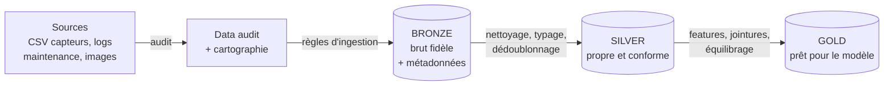

# Analyse et cartographie des données avant le Bronze

**Guide méthodologique — Sprint 1, séquence 03 « Exploration et profiling des données (Data audit) »**
Compétences visées : **C1** (identifier un jeu de données pertinent et cohérent), **C2** (risques éthiques et réglementaires), **C3** (préparer les données pour renforcer leur intégrité).

---

## 1. Ce que tu dois produire

D'après ton parcours, la mise en pratique de la séquence 03 attend :

| Livrable | Contenu | Compétence |
|---|---|---|
| **Notebook de data audit** | Le rapport de profilage commenté | C1, C3 |
| **Dictionnaire de données v0** | Une ligne par colonne : type, unité, sens métier, qualité | C1 |
| **Décision par colonne** | Garder / minimiser / transformer / supprimer, **avec justification** | C1, C2, C3 |
| **Mise à jour de la datasheet** | Qualité, limites, premiers signaux de biais | C2 |

> ⚠️ À l'examen, tu rendras **un notebook** qui sert aussi de **journal de bord**. Prends donc l'habitude dès maintenant de commenter ce que tu observes et ce que tu décides, cellule par cellule. Le jury évalue ton raisonnement, pas seulement le code.

---

## 2. Où se situe cette étape : l'architecture « médaillon »



| Couche | Rôle | Ce qu'on y fait | Ce qu'on n'y fait **pas** |
|---|---|---|---|
| **Bronze** | Copie fidèle et traçable de la source | Ingestion, typage minimal, ajout de métadonnées (fichier source, date d'ingestion, hash) | Corriger, filtrer, imputer |
| **Silver** | Donnée fiable | Nettoyage, dédoublonnage, normalisation, gestion des manquants et des outliers, pseudonymisation | Agrégations métier |
| **Gold** | Donnée prête pour l'usage (le modèle) | Feature engineering, jointures, équilibrage, split | — |

**Pourquoi auditer avant le Bronze ?** Le Bronze ne corrige rien, mais il faut quand même savoir **comment lire** la source sans la déformer : encodage, séparateur, format de date, décimales à virgule, codage des valeurs manquantes. L'audit sert aussi à préparer toutes les décisions du Silver.

---

## 3. Audit et cartographie : de quoi parle-t-on ?

- **Data audit (profiling)** : mesurer objectivement la **qualité** de chaque fichier et de chaque colonne (types, manquants, doublons, distributions, valeurs aberrantes, incohérences).
- **Cartographie des données** : décrire le **paysage** des sources. Quels fichiers, d'où ils viennent, quelles colonnes, quelles **clés** et quelles **relations** (par exemple `machines.machine_id` → `capteurs.machine_id`), et l'intégrité de ces relations (valeurs « orphelines »).

Les deux ensemble répondent à la question C1 : *ce jeu de données permet-il de répondre au besoin métier (prédire les pannes), et à quelles conditions ?*

---

## 4. Les méthodologies de référence (à citer dans ton dossier)

| Référence | Ce qu'elle apporte | Où tu l'utilises |
|---|---|---|
| **CRISP-DM**, phase 2 « Data Understanding » | Le cadre standard : collecter, décrire, explorer, vérifier la qualité | Structure de ton notebook |
| **EDA (Exploratory Data Analysis, J. Tukey)** | Explorer visuellement avant de modéliser : distributions, boxplots, relations | Figures |
| **Dimensions de qualité des données** (ISO/IEC 25012, DAMA-DMBOK) | Une grille d'évaluation : complétude, unicité, validité, cohérence, exactitude, actualité | Grille de lecture de l'audit |
| **Datasheets for Datasets** (Gebru et al.) | Documenter la provenance, la composition, les usages prévus et les limites | Ta datasheet |
| **Privacy by design / RGPD** (minimisation) | Ne garder que les données nécessaires, protéger les données personnelles | Décisions C2 |

### Grille des dimensions de qualité (le cœur de l'audit)

| Dimension | Question | Mesure dans le script |
|---|---|---|
| **Complétude** | Manque-t-il des valeurs ? | % de manquants, jetons du type `""`, `N/A`, `null` |
| **Unicité** | Y a-t-il des doublons ? | Lignes dupliquées, clés candidates |
| **Validité** | Les valeurs respectent-elles le format et le domaine attendus ? | Taux de conversion numérique et date, valeurs négatives impossibles, sentinelles (-1) |
| **Cohérence** | Les mêmes choses sont-elles codées de la même façon ? | `Corrective` contre `corrective`, intégrité référentielle entre fichiers |
| **Exactitude** | Les valeurs reflètent-elles la réalité ? | Outliers IQR, saturation capteur (valeur max répétée) → **à valider avec le métier** |
| **Actualité / continuité** | Les données couvrent-elles la bonne période sans trous ? | Plage de dates, trous temporels |
| **Représentativité** | Toutes les populations sont-elles couvertes ? | Machines ou sites sous-représentés, déséquilibre de la cible |

---

## 5. La démarche en 7 étapes

1. **Inventorier les sources.** Liste des fichiers, taille, format, encodage, séparateur et **hash SHA-256** (preuve de la version auditée).
2. **Lire en brut.** Charger en `dtype=str` pour voir la donnée telle qu'elle est, sans que pandas convertisse silencieusement.
3. **Profiler chaque colonne.** Type inféré, manquants, cardinalité, statistiques, exemples.
4. **Détecter les anomalies.** Doublons, outliers, sentinelles, incohérences de casse, formats de date ambigus, colonnes constantes ou redondantes.
5. **Cartographier.** Clés candidates, relations entre fichiers, valeurs orphelines, diagramme ERD.
6. **Évaluer les risques (C2).** Données personnelles, sous-représentation (biais), déséquilibre de la cible.
7. **Décider et documenter.** Dictionnaire de données + décision justifiée par colonne + limites de l'audit.

---

> **Note** : dans le projet, cette démarche est industrialisée par le package `indusense`
> (`uv run indusense audit`, voir le README). La section ci-dessous décrit le script
> autonome d'origine, utile pour comprendre la logique.

## 6. Le script `data_audit.py`

### Installation et exécution

```bash
pip install pandas numpy matplotlib          # ou : uv add pandas numpy matplotlib
# (optionnel) rapport HTML complémentaire
pip install ydata-profiling

# Pour t'entraîner sans les vraies données :
python generer_donnees_test.py --out data/raw

# Audit d'un dossier complet (ou d'un ou plusieurs fichiers)
python data_audit.py data/raw --out reports/audit_v0 --target panne
python data_audit.py data/raw --out reports/audit_v0 --target panne --profiling
```

### Ce qu'il produit

```
reports/audit_v0/
├── audit_report.md        ← rapport lisible : inventaire, cartographie Mermaid, alertes
├── data_dictionary.csv    ← dictionnaire v0 (s'ouvre dans Excel) avec 4 colonnes à remplir
├── audit_summary.json     ← même contenu, versionnable et comparable entre deux audits
└── figures/
    ├── <fichier>_manquants.png
    ├── <fichier>_distributions.png
    └── <fichier>_boxplots.png
```

### Comment il fonctionne

| Bloc | Fonction | Ce qu'il fait |
|---|---|---|
| 1. Chargement | `load_raw()` | Détecte l'encodage et le séparateur, lit tout en texte, calcule le hash |
| 2. Colonne | `profile_column()` | Manquants (tous codages), inférence de type, stats, données personnelles, action proposée |
| 3. Fichier | `profile_file()` | Doublons, colonnes redondantes (corrélation ≥ 0,95), distribution de la cible |
| 4. Cartographie | `map_relations()`, `mermaid_er()` | Colonnes communes, cardinalité 1-n ou n-n, taux d'inclusion, orphelines, ERD |
| 5. Figures | `plot_file()` | Manquants, histogrammes, boxplots |
| 6. Livrables | `build_dictionary()`, `write_report()` | CSV, JSON, Markdown |

Les **seuils** (5 % de manquants, 0,95 de corrélation, etc.) sont regroupés en tête du script. Ce sont des **choix à justifier** dans ton rapport. Un jury apprécie que tu saches dire pourquoi tu as retenu un seuil.

### Exemple de résultat (sur les données de test)

Le script repère automatiquement, entre autres :
- 50 lignes dupliquées dans `capteurs.csv` ;
- `pression_bar` stockée avec des décimales à virgule, et une valeur sentinelle `-1` répétée ;
- `vibration_mm_s` saturée à `99.9` (capteur bloqué ?) et très asymétrique ;
- `rpm` et `vitesse_rpm_bis` corrélées à 1,0 (redondantes) ;
- `M020` sous-représentée dans les mesures (risque de biais) ;
- `M999` présente dans la maintenance mais absente du référentiel machines (orpheline) ;
- `Corrective` contre `corrective` (incohérence de casse) ;
- `email_technicien`, donnée personnelle à minimiser ;
- une cible `panne` à 8 % (déséquilibre à traiter au sprint 1, séquence 10).

---

## 7. Comment l'utiliser dans ton notebook (le livrable évalué)

Le script fait le travail mécanique ; **la valeur, c'est ton interprétation**. Structure conseillée pour ton notebook :

```python
# 1. Contexte : rappel du besoin métier et des KPI (lien avec la séquence 02)
# 2. Exécution de l'audit
import subprocess
subprocess.run(["python", "data_audit.py", "data/raw", "--out", "reports/audit_v0",
                "--target", "panne"], check=True)

import pandas as pd
dico = pd.read_csv("reports/audit_v0/data_dictionary.csv")
dico[["fichier", "colonne", "type_infere", "pct_manquants", "alertes", "action_proposee"]]
```

Puis, pour chaque fichier, une cellule Markdown du type :

> **Observation** : `vibration_mm_s` contient 30 valeurs exactement égales à 99.9.
> **Hypothèse** : saturation du capteur (valeur plafond), pas une vraie mesure.
> **Vérification** : à confirmer avec le responsable maintenance (fiche technique du capteur).
> **Décision** : en Bronze, conserver tel quel. En Silver, remplacer par NaN et ajouter un indicateur `vibration_saturee`.
> **Justification** : ne pas perdre l'information (une saturation peut précéder une panne) sans fausser les statistiques.

Enfin, complète dans `data_dictionary.csv` les colonnes **`description_metier`, `unite`, `decision`, `justification`** : c'est ton dictionnaire de données v0.

---

## 8. Pièges classiques (que le jury repère)

1. **Nettoyer dans le Bronze.** Le Bronze doit rester rejouable et fidèle à la source.
2. **Supprimer les outliers par réflexe.** En maintenance prédictive, les valeurs extrêmes sont souvent *le signal* que tu cherches. Outlier statistique ≠ erreur.
3. **Laisser pandas deviner les types.** `01/02/2026` peut devenir le 2 janvier ; `6,05` devient du texte. D'où la lecture en `str`.
4. **Calculer des statistiques d'imputation sur tout le jeu.** C'est une fuite de données (*data leakage*) : les moyennes d'imputation se calculent sur le jeu d'entraînement seulement (séquence 08).
5. **Oublier le temps.** Sur des séries temporelles, regarde les trous, la fréquence et la couverture par machine.
6. **Ignorer la conformité.** Une colonne email ou nom de technicien n'a aucune utilité pour prédire une panne → minimisation RGPD (C2).
7. **Ne pas tracer.** Sans hash ni date, impossible de prouver sur quelle version tu as travaillé.

---

## 9. Étape suivante : l'ingestion Bronze

Une fois l'audit fait, l'ingestion Bronze applique **seulement** les règles de lecture et ajoute la traçabilité :

```python
import hashlib, pandas as pd
from datetime import datetime, timezone
from pathlib import Path

def to_bronze(src: Path, sep: str, encoding: str, out_dir: Path) -> Path:
    df = pd.read_csv(src, sep=sep, encoding=encoding, dtype=str, keep_default_na=False)
    df["_source_file"] = src.name
    df["_source_sha256"] = hashlib.sha256(src.read_bytes()).hexdigest()
    df["_ingested_at"] = datetime.now(timezone.utc).isoformat()
    out = out_dir / f"{src.stem}.parquet"      # pip install pyarrow
    df.to_parquet(out, index=False)
    return out
```

Les séquences suivantes construisent ensuite le schéma relationnel (05, SQLAlchemy), le runbook d'ingestion (06), le nettoyage Silver (07), les tests qualité et le split (08). Pour le contrôle automatique des règles détectées ici, tu pourras les transformer en schéma **Pandera** (dans ta boîte à outils du sprint 1).

---

### Checklist avant de passer au Bronze

- [ ] Toutes les sources sont inventoriées, avec leur hash
- [ ] Encodage, séparateur et formats de date sont connus pour chaque fichier
- [ ] Les clés et les relations sont identifiées, les orphelines sont signalées
- [ ] Chaque alerte a une hypothèse et une décision
- [ ] Les données personnelles sont repérées et une décision de minimisation est prise
- [ ] Les biais de représentativité et le déséquilibre de la cible sont notés dans la datasheet
- [ ] Le dictionnaire de données v0 est complété et versionné (Git)
